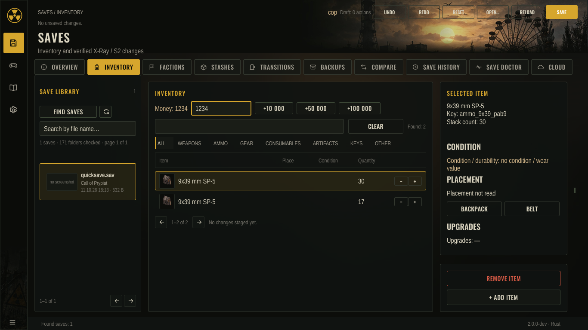
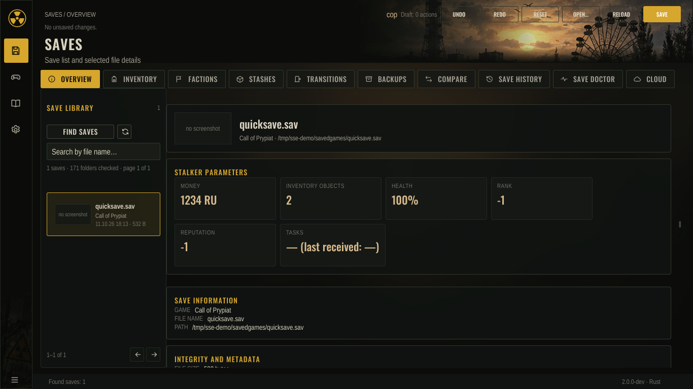
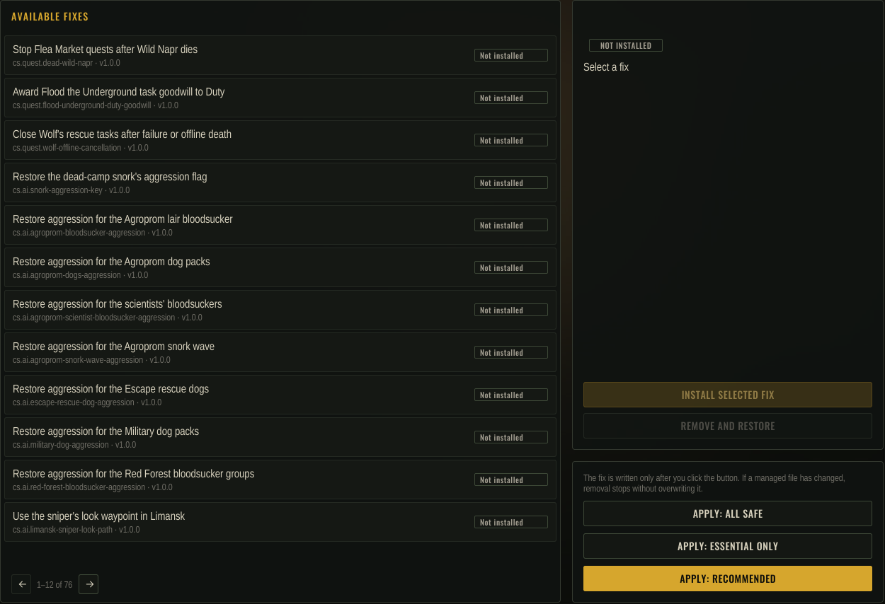
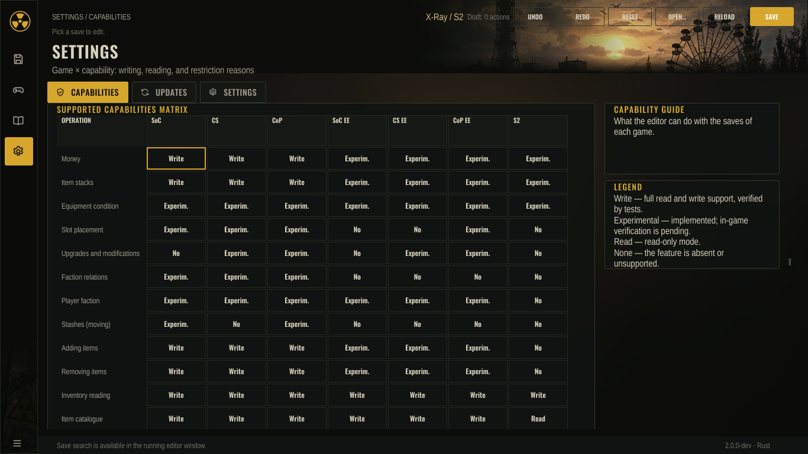

# S.T.A.L.K.E.R. Save Editor

A save editor for the S.T.A.L.K.E.R. series. It reads and edits saves of *Shadow of Chernobyl*, *Clear Sky*,
*Call of Pripyat* and their Enhanced Editions, and of *S.T.A.L.K.E.R. 2: Heart of Chornobyl*. It also applies
game bug fixes, installs an optional in-game companion, and checks game scripts.

Version `2.0.0`. No release has been published yet: there is no tag, no signed update manifest and no Workshop
item. The version is checked by the automated tests only; edits written by it have not been loaded in the games
(one Call of Pripyat save excepted), and Windows and macOS builds were never started by a person. See
[Verification](#verification), the [release notes](docs/RELEASE_NOTES_2.0.0.md) and the
[release procedure](docs/RELEASE.md).



*Inventory: the save's items, with names in the interface language.*



*Overview: the save's parameters, library and integrity details.*



*Game fixes: the catalogue for an installed game, with install state.*



*Capabilities: what the editor can write, read or refuse, per game.*

## What it can do

### Saves

- **X-Ray saves** (Shadow of Chernobyl, Clear Sky, Call of Pripyat and the Enhanced Editions): read the actor's
  money, inventory, ammunition stacks, equipment condition and upgrades. Edits are listed in the table below.
- **S.T.A.L.K.E.R. 2 saves**: read the wallet, backpack and stash. Edits: wallet, ammunition stack count, equipment
  condition, and moving stash items into the backpack. Placement, upgrades, item removal and item addition are refused.
  Saves written by game version 1.0.x can be read but not edited.
- **Every write** keeps the original: a backup copy and a journal are written first, the new file replaces the old one
  atomically, the result is read back and compared, and the original is restored if a step fails.
  See [docs/ARCHITECTURE.md](docs/ARCHITECTURE.md).

### X-Ray edit support

Taken from the capability registry in `crates/sse-xray/src/writer.rs` (`capability()`), which mirrors the C# 1.3.1
reference:

| Change | Shadow of Chernobyl, Clear Sky, Call of Pripyat | Enhanced Editions |
|---|---|---|
| Money | Verified | Experimental (measured on every real save: ТЧ EE 6/6, ЧН EE 8/8, ЗП EE 12/12) |
| Ammunition stacks | Verified | Experimental (ТЧ EE 4/4 and ЧН EE 6/6 measurable saves pass; ЗП EE 12/12; the other saves have no stack to edit) |
| Add items | Verified | Experimental (ТЧ EE 4/4, ЧН EE 6/6 measurable saves pass, undo byte-identical; ЗП EE 12/12; the other saves have no single-item template with a placement) |
| Remove items | Verified | Experimental (ТЧ EE 4/4 and ЧН EE 6/6 measurable saves pass; ЗП EE 12/12; the other saves have no backpack item to remove) |
| Equipment condition | Experimental | Experimental (not loaded in the game yet): ТЧ EE 6/6, ЧН EE 8/8, ЗП EE 12/12 (the restore keeps the client copy untouched where it differs from the state value) |
| Item placement | Experimental | Call of Pripyat EE: Experimental (not loaded in the game yet, 12/12); Shadow of Chernobyl EE, Clear Sky EE: Unsupported (slot occupancy cannot be proven: the equipped item reads as slot 0, so a slot move is refused) |
| Actor faction | Experimental | Experimental (26/26 real saves read the new faction and undo byte-identically) |
| Faction relations | Experimental | Unsupported (none of the 26 Enhanced Edition saves holds an actor relation entry, so nothing to edit) |
| Move items to or from a stash | Experimental (the take into the backpack works; the return to a stash is refused until the game records the item's place) | Clear Sky: Unsupported (a stash item has no proven placement field) |
| Info portions | Experimental | Unsupported |
| Relocate actor | Experimental | Unsupported |
| Upgrades | Clear Sky, Call of Pripyat: Experimental; Shadow of Chernobyl: not in the game | Clear Sky EE, Call of Pripyat EE: Experimental (ЧН EE 8/8, ЗП EE 12/12 add and undo byte-identically); Shadow of Chernobyl EE: Unsupported (no upgrade catalog for it and no upgradeable item in the saves measured) |

*Verified* means the reference fixtures confirm the field. It does not mean a game has loaded the result.
*Experimental* means the reference allows the edit with experimental status: it is checked by the writer and by a
read-back, but no game has loaded it. *Unsupported* means the editor refuses it.

### Game fixes

The dataset (`crates/sse-fixes/data/game-fixes.json`, version `2026.10.1`) has 149 definitions. The Enhanced Editions
get their own variants of the retail fixes, so the screen lists these entries per game (counted by the catalogue tests
in `crates/sse-fixes/tests/catalog_tests.rs`):

| Game | Fixes |
|---|---|
| Shadow of Chernobyl | 35 |
| Shadow of Chernobyl Enhanced Edition | 20 |
| Clear Sky | 76 (75 validated, 1 experimental) |
| Clear Sky Enhanced Edition | 51 |
| Call of Pripyat | 36 |
| Call of Pripyat Enhanced Edition | 25 |
| S.T.A.L.K.E.R. 2 | none |

Fixes are applied only when the user chooses them. Each one is checked against the expected file hashes before it
changes anything, and can be removed again. See [docs/GAME_FIXES.md](docs/GAME_FIXES.md).

### Companion

An optional in-game companion: a Lua mod for the X-Ray games (bundled in the program) and a UE4SS mod for
S.T.A.L.K.E.R. 2. It is installed only on the user's explicit choice and removed exactly as it was installed.
See [docs/COMPANION.md](docs/COMPANION.md).

### Diagnostics

- `stalker-save doctor` reads saves, crash markers and game installations without changing them.
- `stalker-save lint` runs static checks on game scripts.
- A crash marker and a local log are kept. An error report is sent only after the user confirms it.
- Performance metrics stay on the computer unless the user turns on sending and confirms each upload.

See [docs/DIAGNOSTICS.md](docs/DIAGNOSTICS.md).

### Steam

- Finds Steam libraries and installed games.
- Steam Cloud writes are explicit transactions that check the file hash first. An uncertain write is never retried
  automatically.
- Reads achievements.
- Builds Steam Workshop packages for the Enhanced Editions (developer tool `sse-ui-dev --package-ee`,
  [docs/WORKSHOP.md](docs/WORKSHOP.md)). Not uploaded yet and not checked in a game.

### Updates

The user checks for updates on request. The manifest is signed with ECDSA P-256 and the signature is verified before
anything is downloaded. Downloads and platform installs are handled by the installers in `crates/sse-update`.

### Web

`sse-web` hosts the same editor shell in a browser. The build script is `tools/build-web.sh`: it writes
`web/sse_web.wasm` (refused above 5 MiB) and `web/item-icons.bin`. The item pictures are not compiled into the
browser build; the page fetches that file after the editor has started and shows empty icon frames until it
arrives. The whole `web/` folder is what gets served; CI uploads it as the `web` artifact.

## Install

Packages are built by CI (`.github/workflows/ci.yml`) and attached to the workflow run. They are not published
releases.

| Platform | File | Built by CI |
|---|---|---|
| Linux x86_64 | `SaveEditor-linux-x86_64.AppImage` | every pull request |
| Linux x86_64 | `SaveEditor-linux-x86_64.tar.gz` | every pull request |
| Linux x86_64 (Debian, Ubuntu) | `stalker-save-editor_<version>_amd64.deb` | every pull request |
| Windows x86_64 | `SaveEditor-windows-x86_64.zip` (portable, MSVC build) | every pull request |
| Windows x86_64 | `SaveEditor-windows-x86_64-setup.exe` (Inno Setup installer) | every pull request |
| macOS | `SaveEditor-macos-arm64.dmg`, `SaveEditor-macos-x86_64.dmg` | by hand or on a `v*` tag |

The macOS disk images are not signed or notarized by the build script. The release manifest is signed by the
owner, not by CI. See [docs/PACKAGING.md](docs/PACKAGING.md).

Platforms other than those listed here are not built or tested by CI.

## Build from source

The toolchain is pinned in `rust-toolchain.toml` (Rust 1.99.0). The declared minimum is Rust 1.85. There are no
third-party crates; every dependency is another crate in this workspace.

```bash
cargo build --release -p sse-cli -p sse-ui
```

Checks that CI runs:

```bash
cargo fmt --all --check
cargo clippy --workspace --all-targets -- -D warnings
cargo test --workspace
```

## Command line

```text
stalker-save version
stalker-save info <save>
stalker-save inventory <save> [--all]
stalker-save audit [path]
stalker-save doctor save|crash|game|quests ...
stalker-save set-money|set-stack|edit <save> ... (-o OUTPUT | --in-place) [--backup-dir DIR]
stalker-save backups list|restore ...
stalker-save fixes list|state|status|preset|apply-preset|install|update|remove|extract ...
stalker-save lint <game-folder> [--check NAME] [--config SUBDIR] [--json]
stalker-save update check|download|verify-manifest ...
```

Write commands take `--in-place` for a journaled replacement, or `-o`/`--output` for a new file. The two cannot be
combined. Exit codes: `0` done, `2` wrong arguments, `3` refused (unsupported or unsafe), `4` unreadable or damaged
input, `5` file or system error.

## Verification

What the project checks, and where it stops:

- **Automated, in CI:** formatting, clippy with warnings denied, the workspace tests on Linux, Windows and macOS,
  parser fuzz smoke tests, interface performance budgets, translation layout and source checks, and acceptance
  screenshots.
- **Parity with the C# editor:** `tools/oracle.sh` compares output with the C# 1.3.1 command-line editor when
  `SSE_ORACLE` points at it. It is run by hand, not in CI.
- **Not verified:** writes from this version have not been loaded in the game. The game launch and in-game
  loading check is still open (see `TASKS.md`, A15). Synthetic round-trip tests do not prove that the game accepts
  an edit.

## Documentation

- [docs/ARCHITECTURE.md](docs/ARCHITECTURE.md): crates, boundaries, and the save write path.
- [docs/GAME_FIXES.md](docs/GAME_FIXES.md): the fix catalogue and how fixes are applied.
- [docs/COMPANION.md](docs/COMPANION.md): the in-game companion.
- [docs/DIAGNOSTICS.md](docs/DIAGNOSTICS.md): logs, reports and metrics.
- [docs/PACKAGING.md](docs/PACKAGING.md): packages, the release manifest and signing.
- [docs/RELEASE.md](docs/RELEASE.md): the release procedure, step by step, and who does each step.
- [docs/RELEASE_NOTES_2.0.0.md](docs/RELEASE_NOTES_2.0.0.md): release notes for 2.0.0, English and Russian.
- [PLAN.md](PLAN.md), [TASKS.md](TASKS.md), [ACCEPTANCE.md](ACCEPTANCE.md), [AGENTS.md](AGENTS.md): plan,
  open work, acceptance criteria, and rules for contributors.
