# S.T.A.L.K.E.R. Save Editor: user guide

*Also in: [Українська](GUIDE.uk.md) · [Русский](GUIDE.ru.md)*

This guide is for players. It shows how to install the editor, open a save, change it and get the original back,
and it walks through every screen of the program. Button names are written exactly as they appear in the English
interface.

**What you should know first.** The editor makes a backup copy before every change. So far only one edited *Call of
Pripyat* save has been loaded in a game; everything else is checked by the editor itself but not in the games. The
Windows and macOS builds have not been started by a person yet. Keep the backups, and if a game refuses a save,
[put the original back](#9-backups-history-and-comparison).

The pictures were taken from the program with small test saves, so the lists in them are short.

## Contents

1. [Installation](#1-installation)
2. [First run and finding your saves](#2-first-run-and-finding-your-saves)
3. [The window at a glance](#3-the-window-at-a-glance)
4. [Overview](#4-overview)
5. [Inventory](#5-inventory)
6. [Adding an item](#6-adding-an-item)
7. [Factions and transitions](#7-factions-and-transitions)
8. [Stashes](#8-stashes)
9. [Backups, history and comparison](#9-backups-history-and-comparison)
10. [Games overview](#10-games-overview)
11. [Game fixes](#11-game-fixes)
12. [The in-game companion](#12-the-in-game-companion)
13. [Save doctor, game doctor and game environment](#13-save-doctor-game-doctor-and-game-environment)
14. [Steam Cloud and achievements](#14-steam-cloud-and-achievements)
15. [Encyclopedia](#15-encyclopedia)
16. [Updates](#16-updates)
17. [Settings, language and capabilities](#17-settings-language-and-capabilities)
18. [The browser edition](#18-the-browser-edition)
19. [If something went wrong](#19-if-something-went-wrong)
20. [Known limitations](#20-known-limitations)

## 1. Installation

All files are on the [latest release page](https://github.com/Dmitriy-DE/stalker-save-editor-rs/releases/latest).

### Windows

1. Download [SaveEditor-windows-x86_64-setup.exe](https://github.com/Dmitriy-DE/stalker-save-editor-rs/releases/latest/download/SaveEditor-windows-x86_64-setup.exe)
   and run it.
2. Windows shows **"Windows protected your PC"**. This is expected: the installer is not signed with a paid
   certificate. Press **More info**, then **Run anyway**.
3. Follow the installer. At the end it offers to start the editor; later you find it in the Start menu as
   **S.T.A.L.K.E.R. Save Editor**.

If you do not want to install anything, download
[SaveEditor-windows-x86_64.zip](https://github.com/Dmitriy-DE/stalker-save-editor-rs/releases/latest/download/SaveEditor-windows-x86_64.zip),
unpack it anywhere and run `sse-shell.exe`.

### Linux

**AppImage (any distribution).**

1. Download [SaveEditor-linux-x86_64.AppImage](https://github.com/Dmitriy-DE/stalker-save-editor-rs/releases/latest/download/SaveEditor-linux-x86_64.AppImage).
2. Right-click the file → **Properties** → turn on the permission to run it as a program (in GNOME Files:
   **Executable as Program**; in KDE: **Permissions → Is executable**).
3. Double-click the file.

The AppImage does not update itself: for a new version, download the new file.

**Ubuntu, Debian, Linux Mint (.deb).**

1. On the [release page](https://github.com/Dmitriy-DE/stalker-save-editor-rs/releases/latest) download
   `stalker-save-editor_<version>_amd64.deb`.
2. Double-click it. The app centre opens; press **Install** and enter your password.
3. Open **S.T.A.L.K.E.R. Save Editor** from the applications menu.

If double-clicking does not open an installer, open a terminal in the download folder and run
`sudo apt install ./stalker-save-editor_*_amd64.deb`.

**Plain archive.** [SaveEditor-linux-x86_64.tar.gz](https://github.com/Dmitriy-DE/stalker-save-editor-rs/releases/latest/download/SaveEditor-linux-x86_64.tar.gz):
unpack it and run `sse-shell`.

> Versions before 2.0.2 did not start on GNOME with Wayland (the default desktop of current Ubuntu): the window
> never appeared. If that is what you see, download the latest release. Other Wayland desktops (KDE, Sway) have not
> been tried; if the window does not appear there, use the [browser edition](#18-the-browser-edition) and
> [tell us](#19-if-something-went-wrong).

### macOS

1. Download the image for your Mac:
   [Apple chip (M1 and newer)](https://github.com/Dmitriy-DE/stalker-save-editor-rs/releases/latest/download/SaveEditor-macos-arm64.dmg)
   or [Intel](https://github.com/Dmitriy-DE/stalker-save-editor-rs/releases/latest/download/SaveEditor-macos-x86_64.dmg).
2. Open the image and drag **SaveEditor** to the Applications folder.
3. The first time, right-click **SaveEditor** → **Open** → **Open**. The image is not signed by Apple, so a plain
   double-click is refused. On recent macOS versions use **System Settings → Privacy & Security → Open Anyway**.

Needs macOS 11 or newer. The macOS build has not been started by a person yet; if it misbehaves, please
[report it](#19-if-something-went-wrong).

### Nothing to install

Open [stalker-save-editor.pages.dev](https://stalker-save-editor.pages.dev). See
[The browser edition](#18-the-browser-edition).

## 2. First run and finding your saves

The editor starts in the language of your system (you can [change it](#17-settings-language-and-capabilities)).
The first time, it asks whether it may send anonymous error reports: answer **Yes** or **No**, both are fine.

It then looks for saves in the usual folders of the games. Found saves appear on the left under **SAVE LIBRARY**.
If nothing is found, the **FIRST-RUN WIZARD** opens:

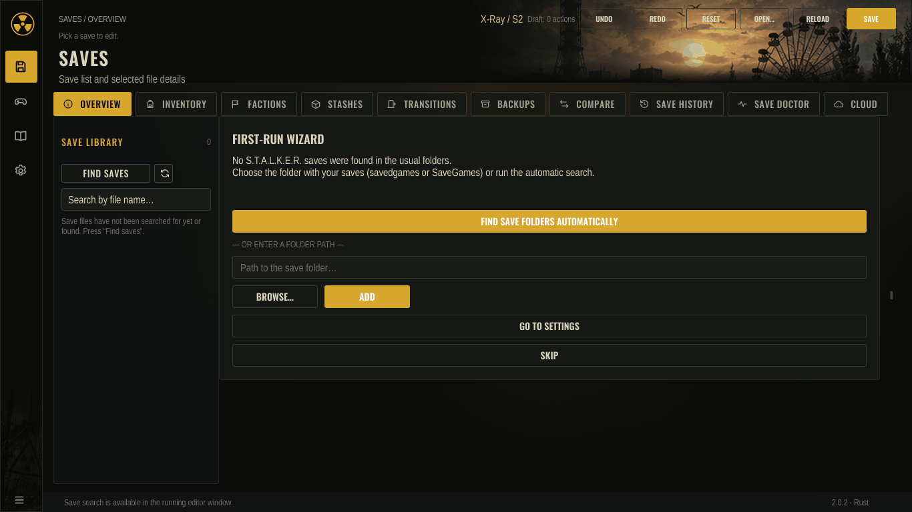

- **FIND SAVE FOLDERS AUTOMATICALLY** searches the disk for save folders.
- Or type the path to your save folder (it is usually called `savedgames` or `SaveGames`) or press **BROWSE…**, then
  **ADD**.
- **GO TO SETTINGS** opens the list of save folders; **SKIP** closes the wizard.

You can always open one file directly: press **OPEN…** at the top of the window, then **BROWSE…**, pick the save and
press **OPEN**.

The editor recognises a save by its content, not by its name, so renamed files open too.

## 3. The window at a glance

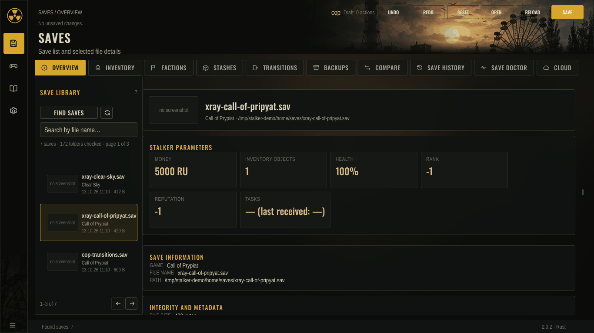

- **Left edge:** four sections. From top to bottom: **SAVES**, **GAMES**, **ENCYCLOPEDIA**, **SETTINGS**. The button at
  the bottom collapses the menu.
- **Tabs under the title:** the screens of the chosen section.
- **SAVE LIBRARY** (on the Saves screens): your saves. **FIND SAVES** searches again, the round arrow refreshes the
  list, the field filters by file name, the arrows at the bottom turn pages.
- **Top right:** the buttons that act on the opened save.

| Button | What it does |
|---|---|
| **UNDO** / **REDO** | Take back the last change in the draft, or bring it back. |
| **RESET** | Throw away all unsaved changes. Press it twice: the first press only warns. |
| **OPEN…** | Open a save file by path. |
| **RELOAD** | Read the save from disk again. |
| **SAVE** | Write the draft into the save file. A backup is made first. |

**The draft.** Nothing you change touches the save until you press **SAVE**. Changes collect in a draft; the counter
next to the buttons (**Draft: 2 actions**) shows how many. The draft survives closing the editor: your unsaved
changes are there when you open it again.

All twenty screens:

| Section | Screen | What it is for |
|---|---|---|
| Saves | **OVERVIEW** | The save list and what is in the chosen save |
| Saves | **INVENTORY** | Money, items, condition, placement, upgrades, adding and removing items |
| Saves | **FACTIONS** | Relations with factions |
| Saves | **STASHES** | Items in stashes; taking them into the backpack |
| Saves | **TRANSITIONS** | Moving the character to another location |
| Saves | **BACKUPS** | Backup copies and restoring the original |
| Saves | **COMPARE** | What differs between two saves |
| Saves | **SAVE HISTORY** | Your saves in order of time |
| Saves | **SAVE DOCTOR** | Checks that a save is readable and looks for problems |
| Saves | **CLOUD** | Steam Cloud files |
| Games | **GAMES OVERVIEW** | Installed games found on this computer |
| Games | **GAME FIXES** | Bug fixes for the game files |
| Games | **GAME DOCTOR** | Checks the game's files and scripts |
| Games | **GAME ENVIRONMENT** | Snapshots and profiles of what the editor changed in a game |
| Games | **COMPANION** | The optional in-game mod |
| Games | **ACHIEVEMENTS** | Steam achievements of the chosen game |
| Encyclopedia | **ENCYCLOPEDIA** | Items of the installed game |
| Settings | **CAPABILITIES** | What can be edited in each game |
| Settings | **UPDATES** | Checking for a new version |
| Settings | **SETTINGS** | Language, look, sound, folders, reports |

## 4. Overview

Click a save in the library. The right side shows:

- **STALKER PARAMETERS**: money, number of items, health, rank, reputation, tasks. The editor shows only what it can
  read reliably from this save, so some values may be missing.
- **SAVE INFORMATION**: the game, the file name and where it is.
- **INTEGRITY AND METADATA**: file size, date, checksums. You do not need these unless you report a problem.

Nothing is edited on this screen.

## 5. Inventory

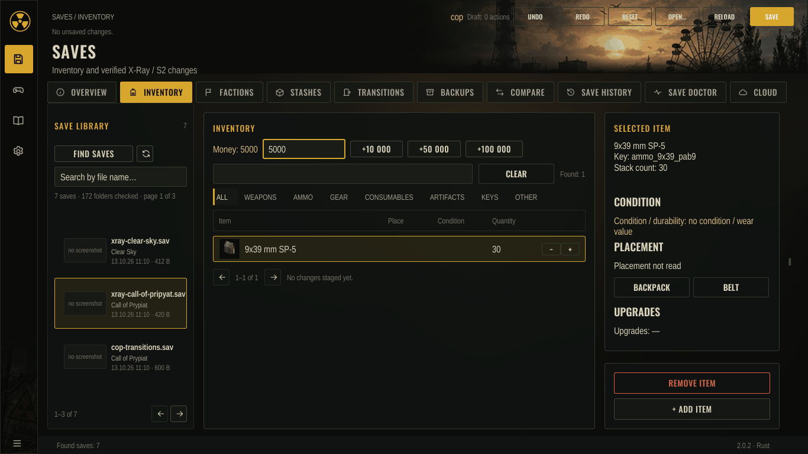

**Money.** Type a number in the **Money** field, or press **+10 000**, **+50 000**, **+100 000**.

**Finding an item.** Type part of its name in the search field (**CLEAR** empties it) or pick a group: **ALL**,
**WEAPONS**, **AMMO**, **GEAR**, **CONSUMABLES**, **ARTIFACTS**, **KEYS**, **OTHER**.

**Ammo and other stacks.** The **−** and **+** buttons in the row change the quantity.

**Click an item** to see it on the right under **SELECTED ITEM**:

- **CONDITION**: **100%**, **75%**, **50%** set the condition of a weapon or armour. Items without a condition (ammo,
  food) show "no condition / wear value".
- **PLACEMENT**: **BACKPACK**, **BELT** or a slot button move the item. The buttons appear only for moves the editor
  can do safely in this save.
- **UPGRADES**: installed upgrades of the item, where the game has them.
- **REMOVE ITEM** deletes the item from the save.

When you are done, press **SAVE** at the top right. The line under the list tells you what is waiting in the draft.

What works in which game: see [Known limitations](#20-known-limitations) and the table in the
[README](../README.md#what-you-can-change-game-by-game).

## 6. Adding an item

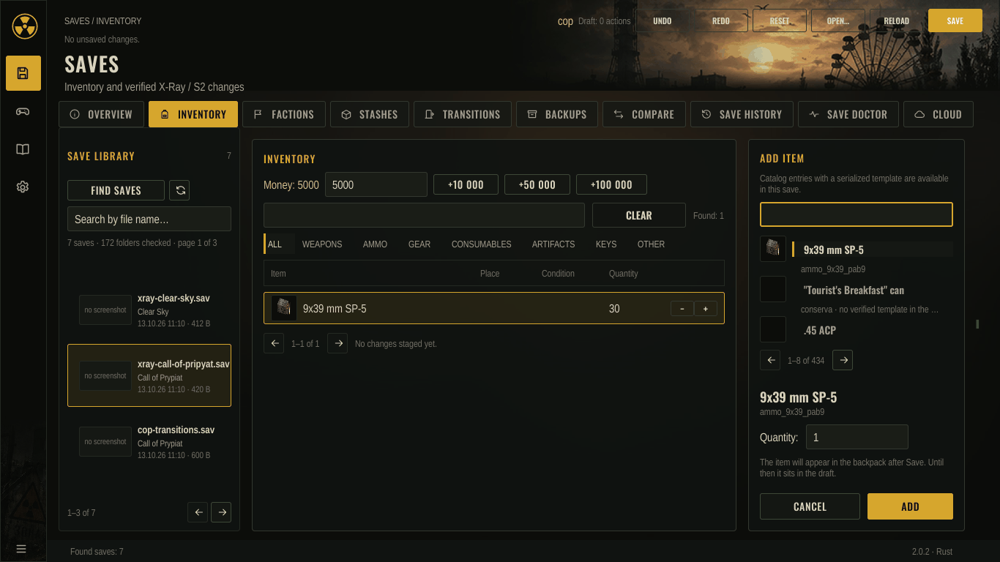

1. On **INVENTORY**, press **+ ADD ITEM**.
2. Type part of the name in the field of the **ADD ITEM** panel and click the item in the list.
3. Set **Quantity**.
4. Press **ADD**. The item goes to the draft.
5. Press **SAVE**. The item appears in the backpack.

The editor adds an item by copying an example of the same kind that is already in your save. Items marked
**no verified template in the save** have no such example and cannot be added to this save. A simple way around it:
in the game, pick up or buy one such item, save, and open that save.

Adding items is not available for S.T.A.L.K.E.R. 2.

## 7. Factions and transitions

### Factions

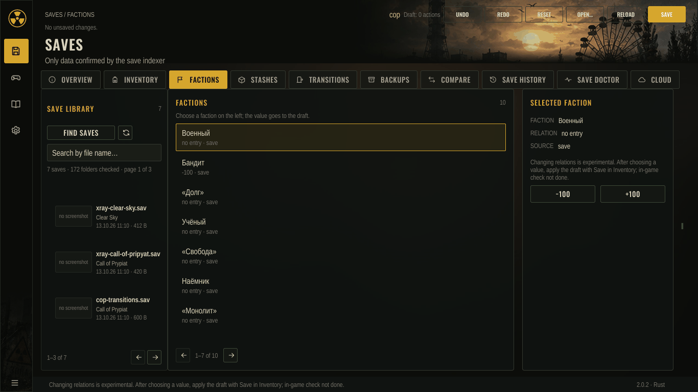

The list shows the factions of the game and your relation with each, where the save has one. Click a faction and
press **−100** or **+100** on the right; then press **SAVE**. This change is experimental: it has not been loaded in
a game yet.

Relations cannot be edited in the Enhanced Editions and in S.T.A.L.K.E.R. 2.

### Transitions

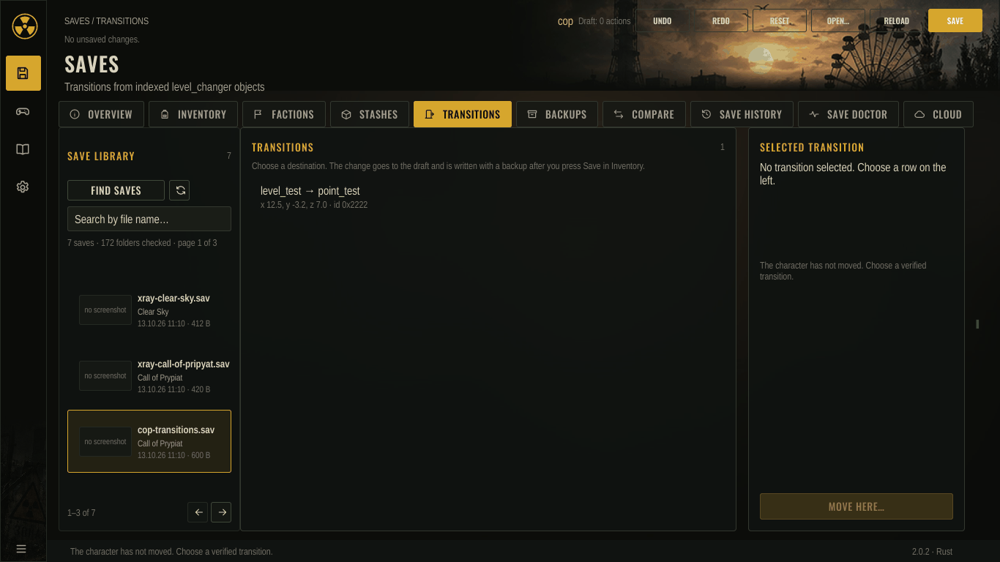

A transition is a passage from one location to another that exists in your save. Choosing one moves the character
to the place where that passage leads.

1. Click a transition in the list.
2. Press **MOVE HERE…** and then **Confirm transfer**.
3. Press **SAVE**.

This works for Shadow of Chernobyl, Clear Sky and Call of Pripyat (not the Enhanced Editions) and is experimental:
not loaded in a game yet.

## 8. Stashes

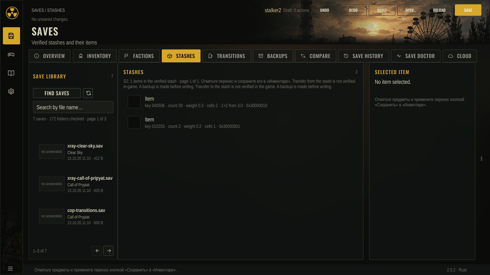

The screen lists the items lying in stashes that the editor could read reliably.

- **Shadow of Chernobyl, Call of Pripyat:** click an item and press **To backpack**. **Undo transfer** takes it back
  while it is still in the draft. After you press **SAVE**, the item is in the backpack. The editor cannot put that
  item back into a stash until the game itself has saved once with it.
- **S.T.A.L.K.E.R. 2:** **Transfer** moves the selected item from the stash to the backpack, **Transfer all** moves
  everything that fits. **TO STASH** and **Transfer all to stash** move items the other way. After the transfer the
  editor tells you how many items were moved and how many were skipped.
- **Clear Sky and the Enhanced Editions:** moving items out of stashes is not available.

All stash transfers are experimental: not loaded in a game yet.

## 9. Backups, history and comparison

### Backups: getting the original back

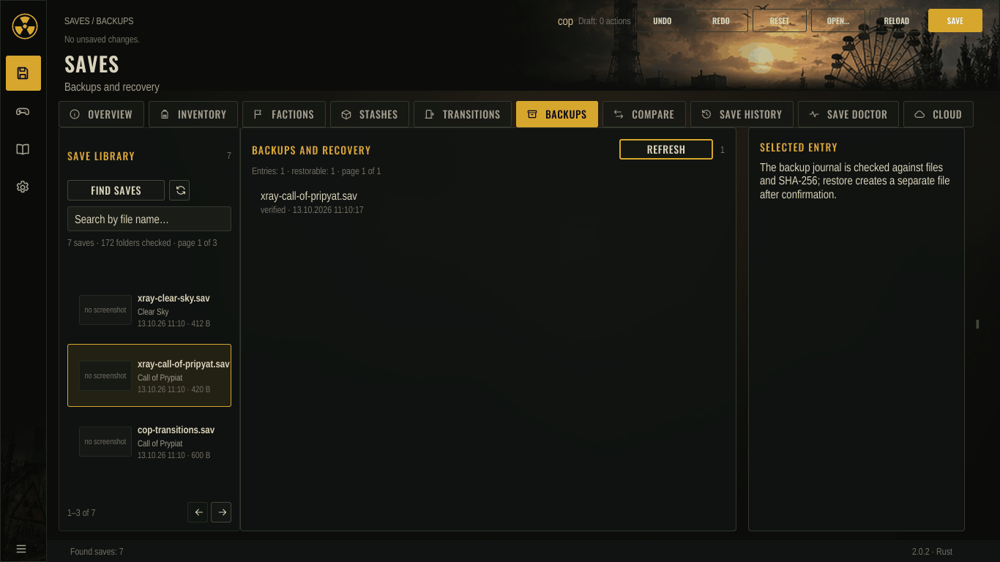

Every time you press **SAVE**, the editor first copies the original save to its backup folder. To return to it:

1. Open **BACKUPS** and press **REFRESH**.
2. Click the entry. Its status should be **verified**.
3. Choose **Restore in place…** to put the original back where the save was, or **Restore to a copy…** to write it
   next to the save under another name.
4. Press **Confirm restore**.

Before a restore in place, the editor makes one more safety copy of the file it is about to replace.

The backup files are kept in `%LOCALAPPDATA%\StalkerSaveEditor\backups` on Windows and in
`~/.local/share/StalkerSaveEditor/backups` on Linux and macOS. In that folder the original is the file whose name
ends with `_ORIGINAL.sav`. You can choose another folder in **SETTINGS → SETTINGS → BACKUPS → BROWSE…**; press **SAVE
SETTINGS** afterwards.

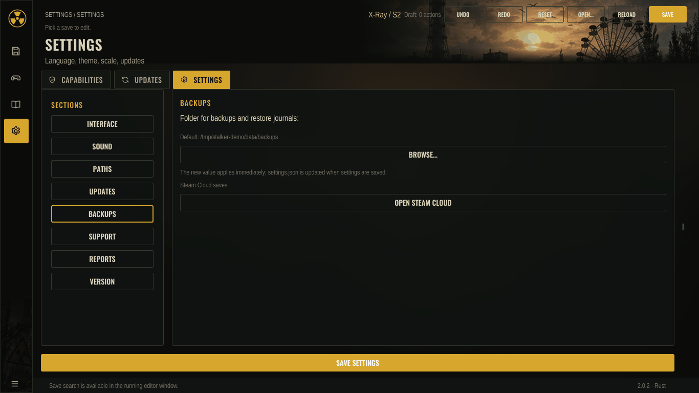

If the editor was closed or the computer lost power in the middle of a write, the next start opens this screen so
that you can finish the recovery.

### Save history

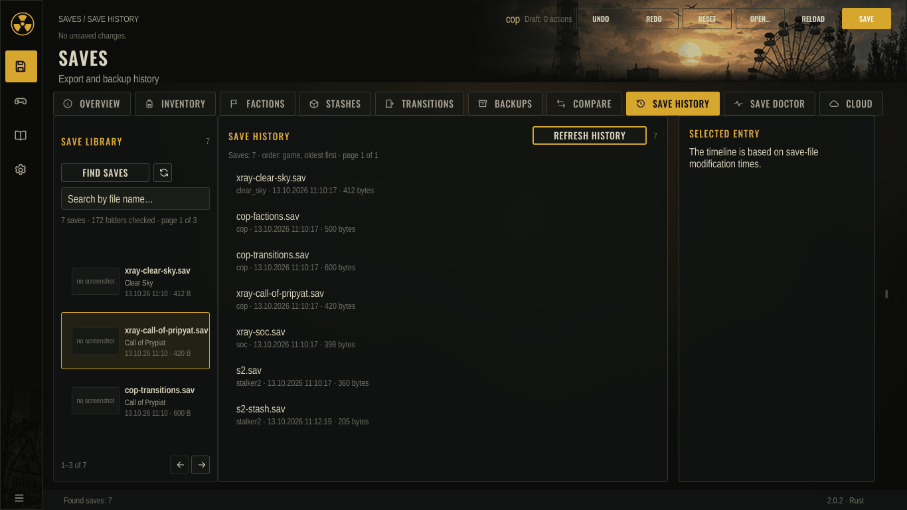

**REFRESH HISTORY** lists your saves from oldest to newest by the time the files were changed, with the game and
the size of each. It is a quick way to find "the save before the last one".

### Compare

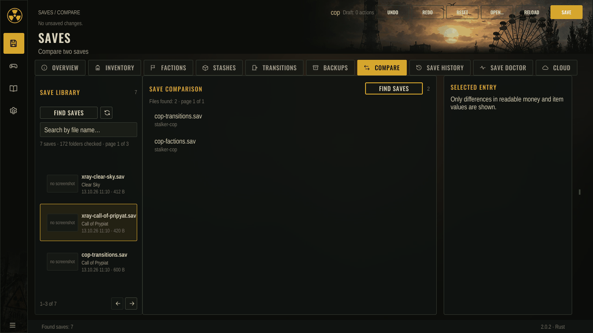

Open a save, go to **COMPARE** and press **FIND SAVES**: the list shows the other saves of the same game. Click one,
and the right side shows what differs between it and the opened save in money and items (added, removed, changed).
With no save opened, click two saves of the same game one after the other. Saves of different games cannot be
compared.

## 10. Games overview

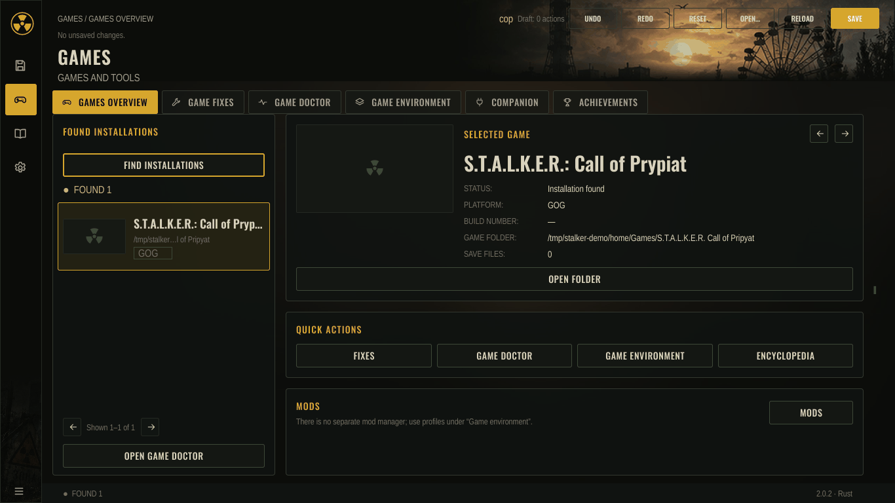

Open the **GAMES** section. **FIND INSTALLATIONS** looks for installed games (Steam, GOG, Heroic and the usual game
folders). Click a found game: the right side shows its platform, build number, folder and the number of saves.
The arrows at the top right switch between games.

- **OPEN FOLDER** opens the game folder.
- **QUICK ACTIONS** lead to the other screens for this game: **FIXES**, **GAME DOCTOR**, **GAME ENVIRONMENT**,
  **ENCYCLOPEDIA**.

The game you choose here is the one that the Fixes, Doctor, Environment, Companion and Achievements screens work
with. If your game is not found, set its folder by hand on the **COMPANION** screen under **GAME FOLDER (MANUAL)**.

## 11. Game fixes

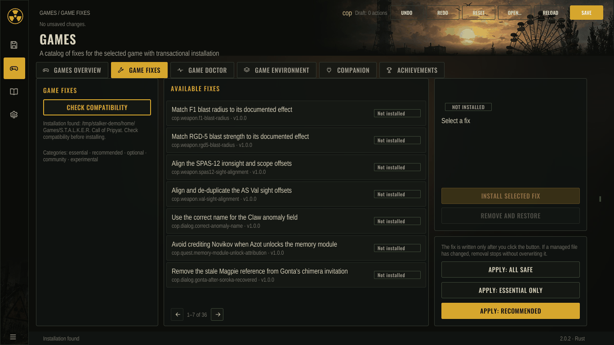

Fixes repair known bugs in the files of the games: wrong weapon values, broken dialogue lines, quests that cannot
be finished. There are fixes for Shadow of Chernobyl, Clear Sky, Call of Pripyat and their Enhanced Editions; none
for S.T.A.L.K.E.R. 2. The names of the fixes are in English in every interface language.

**To install a fix:**

1. Close the game. Choose it on [GAMES OVERVIEW](#10-games-overview).
2. Open **GAME FIXES** and press **CHECK COMPATIBILITY**. The editor compares the game files with the ones each fix
   expects.
3. Click a fix to read what it does, then press **INSTALL SELECTED FIX** and **CONFIRM**.

Or install a set at once: **APPLY: ESSENTIAL ONLY**, **APPLY: RECOMMENDED** or **APPLY: ALL SAFE**.

**To remove a fix:** click it and press **REMOVE AND RESTORE**. The game file returns to what it was. If you or
another mod changed that file after the fix was installed, the editor stops and leaves the file alone (the fix then
shows **File changed after installation**).

A fix is applied only when the game file is exactly the one the fix was made for; otherwise the editor refuses and
changes nothing. A few fixes download one extra file during installation.

The fixes are checked against the game files but have not been tried in a running game yet.

## 12. The in-game companion

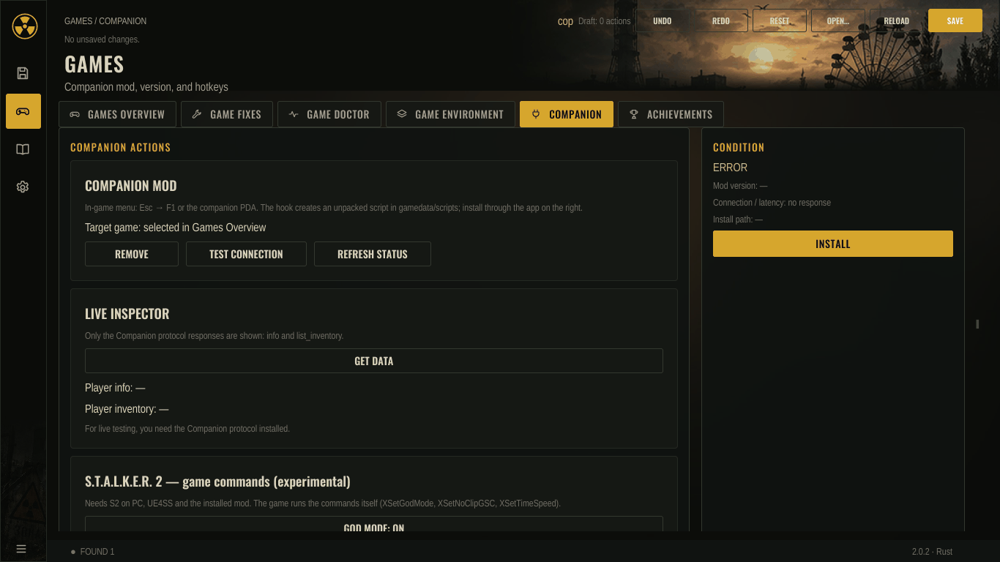

The companion is an optional mod. With it, the editor can act on the game while it is running, without reloading
a save: give items and money, heal, repair what you wear, teleport within the location, read the inventory.

**To install it:**

1. Close the game. Choose it on [GAMES OVERVIEW](#10-games-overview).
2. Open **COMPANION** and press **INSTALL**, then **CONFIRM**.
3. The state changes to **INSTALLED (WAITING FOR THE GAME)**. Start the game and load a save: the state becomes
   **RUNNING (CONNECTED)**. **TEST CONNECTION** checks it at any time.

**In the game:** press **Esc**, then **F1**. The companion menu opens.

**In the editor**, while the game runs:

- **LIVE INSPECTOR → GET DATA** shows the player's data and inventory as the game has them right now.
- **HOTKEYS**: keys for **Heal**, **Repair equipped gear**, **Save marker**, **Jump to last marker** and **Quicksave**.
  Set the keys, press **SAVE KEYS**, then **ENABLE HOTKEYS**. **DEFAULTS** brings the standard keys back.
- **S.T.A.L.K.E.R. 2 — game commands (experimental)**: **God mode**, **Free flight**, **Time ×5**. They need the PC
  version of the game with UE4SS and the mod installed.
- **ALL GAMES → INSTALL / UPDATE IN ALL CHECKED** installs or updates the companion in several games at once.

**To remove it:** press **REMOVE**. The editor deletes exactly the files it installed and restores the game script it
changed.

**Enhanced Editions.** For these the companion is meant to come through Steam Workshop (**SUBSCRIBE IN STEAM**).
The Workshop packages are not published yet, so the editor shows "The Steam Workshop package has not been published
yet".

The companion has not been tried in a running game with this version of the editor.

## 13. Save doctor, game doctor and game environment

### Save doctor

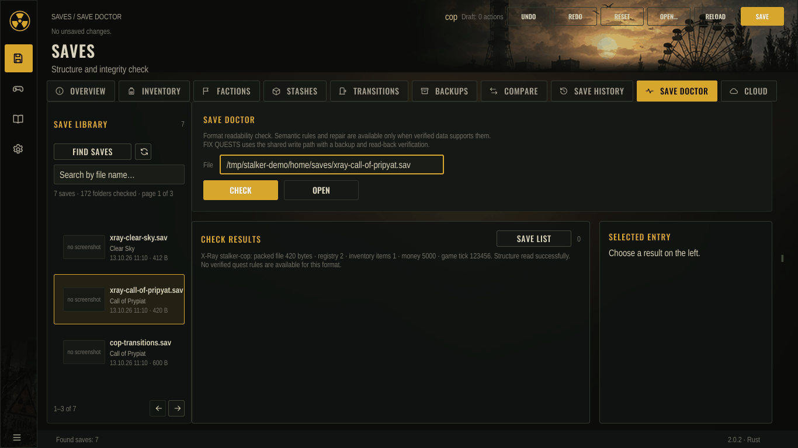

The save doctor reads a save and tells you whether its structure is intact. The opened save is already in the
**File** field; press **CHECK**. **SAVE LIST** shows other saves to check; **OPEN** opens the checked file in the
editor.

For some games the doctor also knows quests that can get stuck. If it finds one, it offers **FIX QUESTS** (the fix is
written like any other change: with a backup and a check) or **INSTALL GAME FIX** when the cause is in the game
files.

### Game doctor

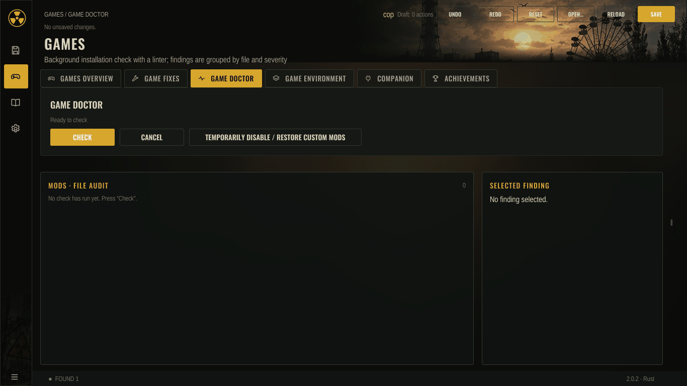

The game doctor checks the files and scripts of the chosen game and lists what it finds, grouped by file and by how
serious it is. Press **CHECK**; **CANCEL** stops a running check. Click a finding to read the details on the right.
The check only reads files.

**TEMPORARILY DISABLE / RESTORE CUSTOM MODS** is for S.T.A.L.K.E.R. 2: it switches your mods off to see whether the
game works without them, and brings them back. It asks for confirmation first.

### Game environment

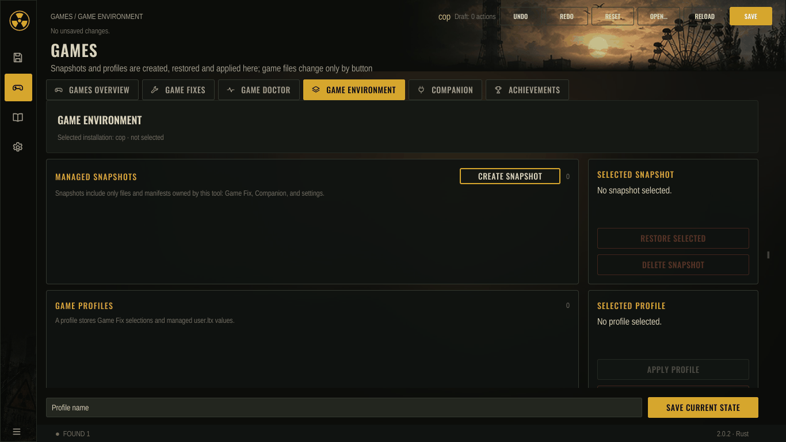

This screen remembers what the editor itself changed in a game (fixes, the companion, managed settings), so that
you can return to that state.

- **MANAGED SNAPSHOTS**: **CREATE SNAPSHOT** records the current state. **RESTORE SELECTED** returns to it;
  **DELETE SNAPSHOT** removes the record. Snapshots exist for the X-Ray games only.
- **GAME PROFILES**: type a **Profile name** and press **SAVE CURRENT STATE** to keep a named set of fixes and
  settings; **APPLY PROFILE** switches to it; **DELETE PROFILE** removes it.

A snapshot covers only what the editor installed. It is not a copy of the whole game.

## 14. Steam Cloud and achievements

Both screens need Steam to be running and signed in.

### Cloud

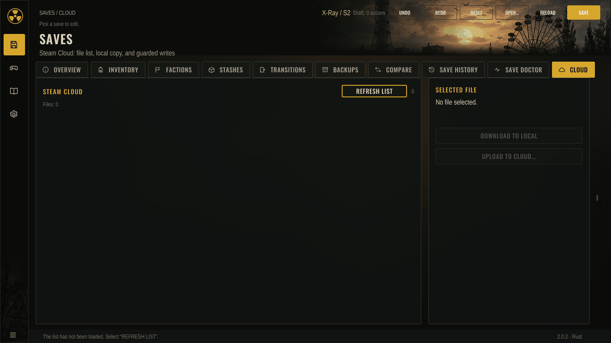

**REFRESH LIST** shows the saves of the chosen game that are stored in Steam Cloud. Click a file, then:

- **DOWNLOAD TO LOCAL** copies it to your computer so that you can open and edit it.
- **UPLOAD TO CLOUD...** replaces the cloud file with your local save. The editor shows both files, asks you to tick
  **I confirm the overwrite**, and only then **WRITE** works. If a cloud write fails halfway, the editor does not try
  again by itself.

Writing S.T.A.L.K.E.R. 2 saves to Steam Cloud is switched off.

### Achievements

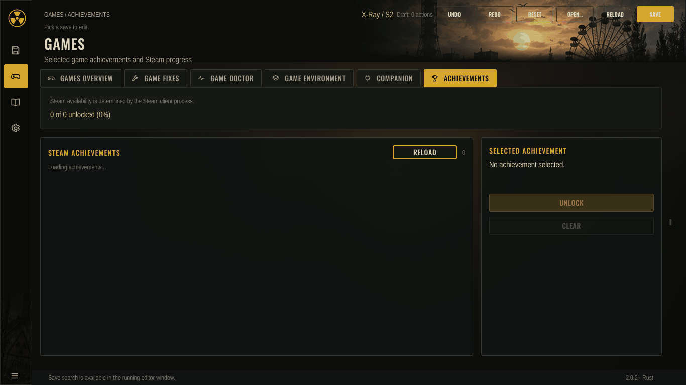

**RELOAD** reads the achievements of the chosen game from Steam. Click one and press **UNLOCK** or **CLEAR**; the
editor asks you to confirm. The change is made in your Steam account, not in a save, and it is visible in Steam.

## 15. Encyclopedia

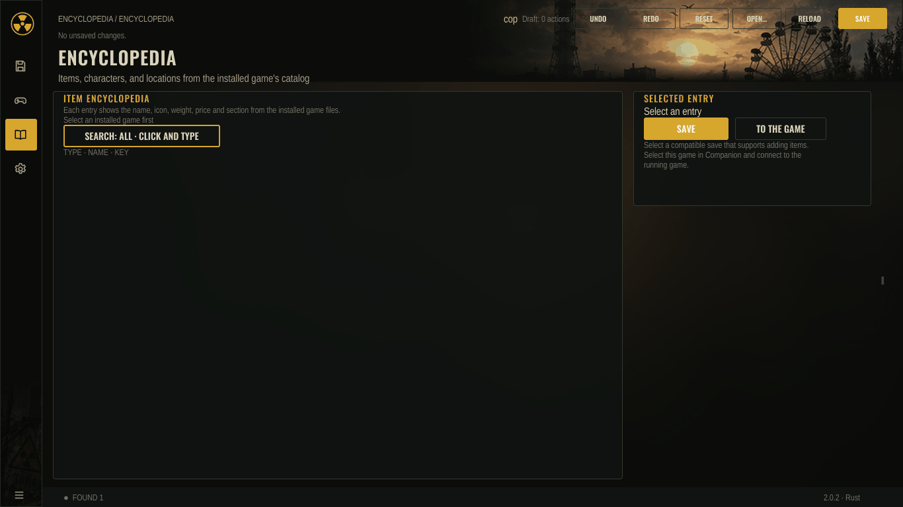

The encyclopedia lists the items of an installed game with their names, pictures, weight and price, read from the
game's own files. Choose a game on [GAMES OVERVIEW](#10-games-overview) first. Click **SEARCH** and type to filter.

For a selected entry, **SAVE** adds the item to the opened save (the same rules as in
[Adding an item](#6-adding-an-item)), and **TO THE GAME** gives it to you in the running game through the
[companion](#12-the-in-game-companion).

## 16. Updates

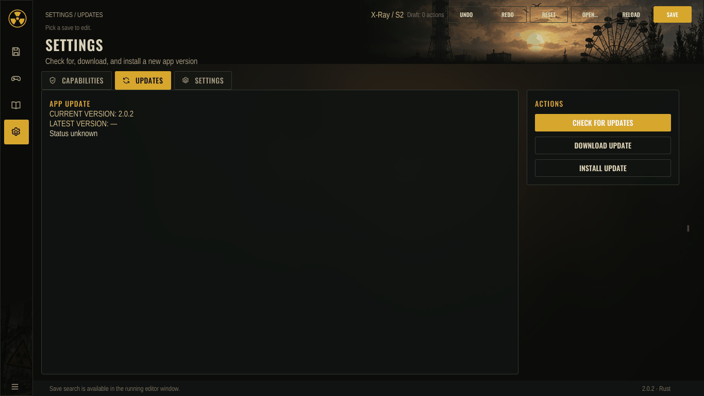

The editor checks for a new version only when you ask.

1. **SETTINGS → UPDATES → CHECK FOR UPDATES**.
2. If there is one, press **DOWNLOAD UPDATE**, then **INSTALL UPDATE**.

Before downloading, the editor verifies the signature of the update list, and it refuses a file that does not
match. The Windows installer version and the `.deb` version install the update for you (the `.deb` asks for your
password); on macOS the editor opens the downloaded image. The AppImage does not update itself: download the new file from the release page. If the editor says
"No package is available for this installation", do the same.

## 17. Settings, language and capabilities

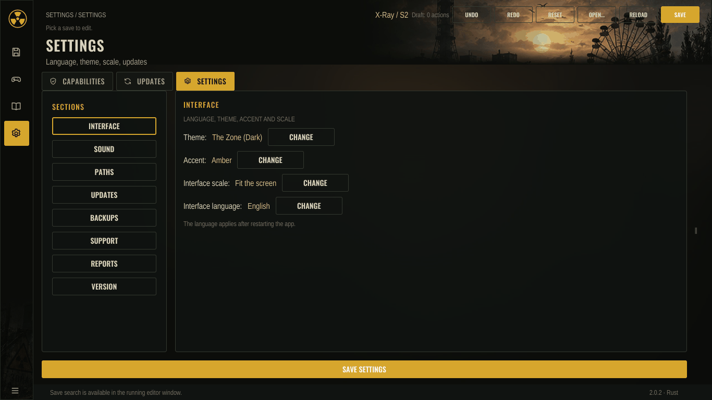

Open **SETTINGS → SETTINGS**. Choose a section on the left, and press **SAVE SETTINGS** at the bottom when you are
done.

| Section | What is there |
|---|---|
| **INTERFACE** | **Theme** (The Zone (Dark), Clear Sky, Day), **Accent** colour, **Interface scale** (fit the screen, or 100–200%), **Interface language**. Each **CHANGE** button switches to the next value. |
| **SOUND** | Interface sounds and menu music on or off, and their volume. |
| **PATHS** | The folders where the editor looks for saves. |
| **UPDATES** | A shortcut to the Updates screen. |
| **BACKUPS** | The folder for backup copies (**BROWSE…**) and a shortcut to Steam Cloud (**OPEN STEAM CLOUD**). |
| **SUPPORT** | **Check environment** and **Save report…**: a file to attach when you report a bug. |
| **REPORTS** | Whether anonymous error reports are sent, and separate consent for performance statistics. |
| **VERSION** | The version of the editor. |

**Language.** Press **CHANGE** next to **Interface language** until you see yours, press **SAVE SETTINGS** and restart
the editor. There are 15 languages: Russian, Ukrainian, English, German, French, Italian, Spanish, Polish, Czech,
Brazilian Portuguese, Turkish, Japanese, Korean, Simplified and Traditional Chinese. The translations have not been
proofread by native speakers; Chinese, Japanese and Korean need a system font with those characters.

**Privacy.** Nothing is sent without your consent. Error reports never contain your saves, file paths or game logs.
A report you save with **Save report…** stays on your computer until you attach it somewhere yourself.

### Capabilities

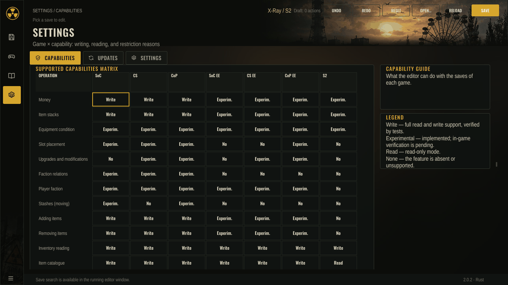

**SETTINGS → CAPABILITIES** is the table of what the editor can do in each game. Columns are games (SoC, CS, CoP,
their Enhanced Editions, S2), rows are kinds of changes.

- **Write**: fully supported.
- **Experim.**: implemented, but not checked in the game yet.
- **Read**: shown, cannot be changed.
- **No**: not available.

Click a cell to read the reason. One cell is out of date in this version: stash transfers for S.T.A.L.K.E.R. 2 show
**No**, but they are available on the [Stashes](#8-stashes) screen. The row **Player faction** describes what the
editor is able to write, but there is no button for it on any screen yet.

## 18. The browser edition

[stalker-save-editor.pages.dev](https://stalker-save-editor.pages.dev) is the same editor running inside a web
page.

1. Press **OPEN…** and pick the save file.
2. Edit it as described above.
3. Press **SAVE**. The browser downloads the edited copy. Put it into the game's save folder yourself; the file you
   opened is not changed.

The save is read and changed inside your browser and is not uploaded anywhere.

**What is different from the installed program:**

- It cannot search your disk for saves or write into the game's folder, so opening and saving are done by hand.
  The file you opened stays on disk unchanged, so it is your backup: do not overwrite it until the game has loaded
  the edited copy.
- Only the Saves screens, **CAPABILITIES** and **SETTINGS** are there. There is no Games section (fixes, companion,
  doctor, achievements), no Steam Cloud, no encyclopedia and no updates: the page is always the current version.
- Item pictures load a moment after the page opens.

## 19. If something went wrong

**The game does not load an edited save, or something in it is wrong.**
Put the original back: [BACKUPS → Restore in place… → Confirm restore](#9-backups-history-and-comparison). Then
please report which game and which change it was.

**"SAVE" refuses to write.**
- The game is running: close it and press **SAVE** again.
- The change is not available for this game: the message says so. See [Known limitations](#20-known-limitations).
- The save file changed on disk after you opened it (for example, the game saved over it): press **RELOAD** and
  make the change again.

**The save does not open.**
The editor says whether the file is not a S.T.A.L.K.E.R. save or is damaged. Try [SAVE DOCTOR](#13-save-doctor-game-doctor-and-game-environment)
for details. A save of a heavily modded game may not be readable.

**The editor does not find my saves or my game.**
Add the save folder by hand ([first-run wizard](#2-first-run-and-finding-your-saves) or **SETTINGS → PATHS**), or
open the file with **OPEN…**. For a game, set the folder under **COMPANION → GAME FOLDER (MANUAL)**.

**Linux: the window does not appear.**
Versions before 2.0.2 did not start on GNOME with Wayland: download the latest release. For the AppImage, check
that running it as a program is allowed. Other Wayland desktops (KDE, Sway) have not been tried.

**Windows or an antivirus blocks the installer.**
The installer is not signed. Press **More info → Run anyway**. To be sure the file is genuine, compare its SHA-256
with the `.sha256` file next to it on the release page.

**How to report a problem.**
Open **SETTINGS → SUPPORT**, press **Save report…** and attach the file to a new
[issue](https://github.com/Dmitriy-DE/stalker-save-editor-rs/issues). Say which game, which change, and what
happened. Do not attach your whole save folder; one save that shows the problem is enough.

## 20. Known limitations

**Not checked in the games.** Edits of Shadow of Chernobyl, Clear Sky, the three Enhanced Editions and
S.T.A.L.K.E.R. 2 have not been loaded in the games; one edited Call of Pripyat save has. The companion and the game
fixes have not been tried in a running game. Nobody has listened to the sound.

**Not started by a person:** the Windows and macOS builds. The macOS images are not signed.

**S.T.A.L.K.E.R. 2**

- Items cannot be added or removed.
- Upgrades, item placement and faction relations cannot be edited.
- Saves made by game version 1.0.x can be read but not edited: load and save them once in the current game first.
- Saves cannot be written to Steam Cloud from the editor.

**Shadow of Chernobyl, Clear Sky, Call of Pripyat**

- Shadow of Chernobyl: upgrades cannot be edited.
- Clear Sky: items cannot be taken out of stashes.
- Shadow of Chernobyl and Call of Pripyat: an item the editor took out of a stash cannot be put back until the game
  has saved once with it.

**Enhanced Editions**

- Faction relations cannot be edited, items cannot be taken out of stashes, and the character cannot be moved to
  another location.
- Shadow of Chernobyl EE and Clear Sky EE: items cannot be moved between slots, belt and backpack.
- Shadow of Chernobyl EE: upgrades cannot be edited.
- The companion's Steam Workshop packages are not published yet.

**Other**

- There is no button to change the player's faction, although the capabilities table has such a row.
- There is no APT repository yet; the `.deb` is installed by hand and updated from the editor.
- Translations have not been proofread by native speakers. In some places text of another language shows through
  (for example, item and faction names in Russian in the English interface).

The full table is in [CAPABILITIES.md](CAPABILITIES.md); the release notes are
[2.0.0](RELEASE_NOTES_2.0.0.md), [2.0.1](RELEASE_NOTES_2.0.1.md) and [2.0.2](RELEASE_NOTES_2.0.2.md).

*This is an unofficial fan project. It is not made, endorsed or supported by GSC Game World.*
