# S.T.A.L.K.E.R. Save Editor: руководство пользователя

*На других языках: [English](GUIDE.md) · [Українська](GUIDE.uk.md)*

Это руководство для игроков. В нём — как поставить редактор, открыть сейв, изменить его и вернуть оригинал, и что
находится на каждом экране программы. Названия кнопок написаны точно так, как в русском интерфейсе.

**Что важно знать заранее.** Перед каждым изменением редактор делает резервную копию. В игре пока загружен только
один изменённый сейв «Зова Припяти»; всё остальное редактор проверяет сам, но в играх это не проверялось. Сборки для
Windows и macOS человек ещё не запускал. Не удаляйте резервные копии, а если игра не грузит сейв —
[верните оригинал](#9-резервные-копии-история-и-сравнение).

Снимки экрана сделаны в программе на маленьких тестовых сейвах, поэтому списки на них короткие.

## Содержание

1. [Установка](#1-установка)
2. [Первый запуск и поиск сейвов](#2-первый-запуск-и-поиск-сейвов)
3. [Окно программы](#3-окно-программы)
4. [Обзор](#4-обзор)
5. [Инвентарь](#5-инвентарь)
6. [Добавление предмета](#6-добавление-предмета)
7. [Фракции и переходы](#7-фракции-и-переходы)
8. [Тайники](#8-тайники)
9. [Резервные копии, история и сравнение](#9-резервные-копии-история-и-сравнение)
10. [Обзор игр](#10-обзор-игр)
11. [Исправления игр](#11-исправления-игр)
12. [Компаньон в игре](#12-компаньон-в-игре)
13. [Доктор сохранения, доктор игры и среда игры](#13-доктор-сохранения-доктор-игры-и-среда-игры)
14. [Steam Cloud и достижения](#14-steam-cloud-и-достижения)
15. [Энциклопедия](#15-энциклопедия)
16. [Обновления](#16-обновления)
17. [Настройки, язык и возможности](#17-настройки-язык-и-возможности)
18. [Версия для браузера](#18-версия-для-браузера)
19. [Если что-то пошло не так](#19-если-что-то-пошло-не-так)
20. [Известные ограничения](#20-известные-ограничения)

## 1. Установка

Все файлы лежат на [странице последнего выпуска](https://github.com/Dmitriy-DE/stalker-save-editor-rs/releases/latest).

### Windows

1. Скачайте [SaveEditor-windows-x86_64-setup.exe](https://github.com/Dmitriy-DE/stalker-save-editor-rs/releases/latest/download/SaveEditor-windows-x86_64-setup.exe)
   и запустите.
2. Windows покажет окно **«Система Windows защитила ваш компьютер»**. Так и должно быть: установщик не подписан
   платным сертификатом. Нажмите **«Подробнее»**, затем **«Выполнить в любом случае»**.
3. Пройдите установку. В конце установщик предложит запустить редактор; потом он находится в меню «Пуск» под именем
   **S.T.A.L.K.E.R. Save Editor**.

Если ничего ставить не хочется, скачайте
[SaveEditor-windows-x86_64.zip](https://github.com/Dmitriy-DE/stalker-save-editor-rs/releases/latest/download/SaveEditor-windows-x86_64.zip),
распакуйте в любую папку и запустите `sse-shell.exe`.

### Linux

**AppImage (любой дистрибутив).**

1. Скачайте [SaveEditor-linux-x86_64.AppImage](https://github.com/Dmitriy-DE/stalker-save-editor-rs/releases/latest/download/SaveEditor-linux-x86_64.AppImage).
2. Щёлкните по файлу правой кнопкой → **«Свойства»** → разрешите запускать его как программу (в «Файлах» GNOME:
   **«Исполняемый как программа»**; в KDE: **«Права» → «Является выполняемым»**).
3. Откройте файл двойным щелчком.

AppImage сам не обновляется: для новой версии скачайте новый файл.

**Ubuntu, Debian, Linux Mint (.deb).**

1. На [странице выпуска](https://github.com/Dmitriy-DE/stalker-save-editor-rs/releases/latest) скачайте
   `stalker-save-editor_<версия>_amd64.deb`.
2. Откройте его двойным щелчком. Откроется центр приложений; нажмите **«Установить»** и введите пароль.
3. Найдите **S.T.A.L.K.E.R. Save Editor** в меню приложений.

Если двойной щелчок не открывает установку, откройте терминал в папке загрузок и выполните
`sudo apt install ./stalker-save-editor_*_amd64.deb`.

**Обычный архив.** [SaveEditor-linux-x86_64.tar.gz](https://github.com/Dmitriy-DE/stalker-save-editor-rs/releases/latest/download/SaveEditor-linux-x86_64.tar.gz):
распакуйте и запустите `sse-shell`.

> Версии до 2.0.2 не запускались в GNOME на Wayland (обычный рабочий стол нынешней Ubuntu): окно не появлялось.
> Если у вас так, скачайте последний выпуск. Другие рабочие столы на Wayland (KDE, Sway) не проверялись; если окно
> не появляется там, пользуйтесь [версией для браузера](#18-версия-для-браузера) и
> [сообщите нам](#19-если-что-то-пошло-не-так).

### macOS

1. Скачайте образ для своего Mac:
   [процессор Apple (M1 и новее)](https://github.com/Dmitriy-DE/stalker-save-editor-rs/releases/latest/download/SaveEditor-macos-arm64.dmg)
   или [Intel](https://github.com/Dmitriy-DE/stalker-save-editor-rs/releases/latest/download/SaveEditor-macos-x86_64.dmg).
2. Откройте образ и перетащите **SaveEditor** в папку «Программы».
3. В первый раз щёлкните по **SaveEditor** правой кнопкой → **«Открыть»** → **«Открыть»**. Образ не подписан Apple,
   поэтому обычный двойной щелчок не сработает. В новых версиях macOS то же разрешение даётся в **«Системные
   настройки» → «Конфиденциальность и безопасность» → «Всё равно открыть»**.

Нужна macOS 11 или новее. Сборку для macOS человек ещё не запускал; если она ведёт себя неправильно,
[сообщите об этом](#19-если-что-то-пошло-не-так).

### Ничего не ставить

Откройте [stalker-save-editor.pages.dev](https://stalker-save-editor.pages.dev). Подробности — в разделе
[«Версия для браузера»](#18-версия-для-браузера).

## 2. Первый запуск и поиск сейвов

Редактор запускается на языке вашей системы (язык можно [сменить](#17-настройки-язык-и-возможности)). При первом
запуске он спросит, можно ли отправлять анонимные отчёты об ошибках: ответьте **«Да»** или **«Нет»**, подойдёт любой
ответ.

Затем он ищет сейвы в обычных папках игр. Найденные сейвы появляются слева, в **БИБЛИОТЕКЕ СОХРАНЕНИЙ**. Если ничего
не найдено, открывается **МАСТЕР ПЕРВОГО ЗАПУСКА**:

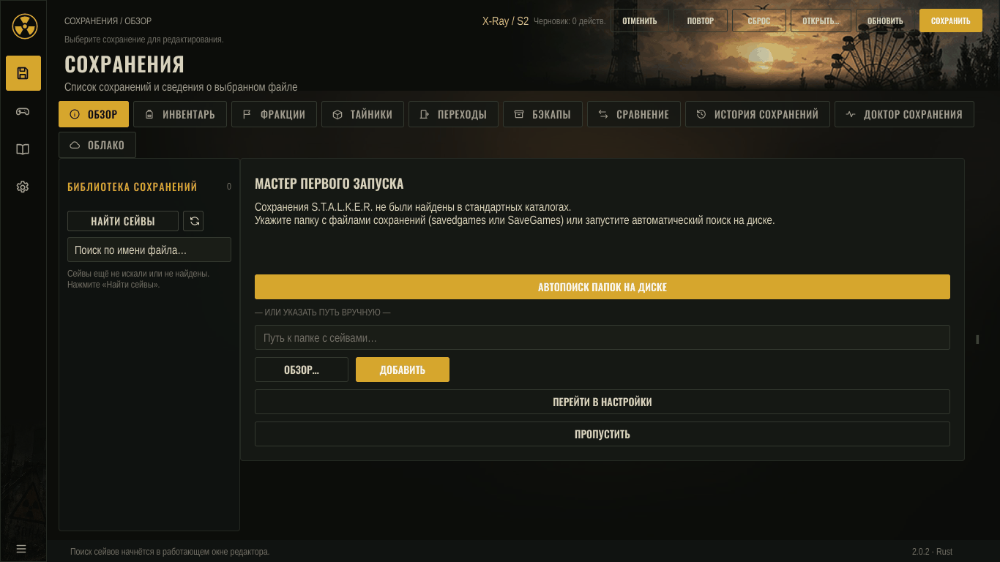

- **АВТОПОИСК ПАПОК НА ДИСКЕ** ищет папки с сейвами на диске.
- Или впишите путь к папке с сейвами (обычно она называется `savedgames` или `SaveGames`) либо нажмите **ОБЗОР…**,
  затем **ДОБАВИТЬ**.
- **ПЕРЕЙТИ В НАСТРОЙКИ** открывает список папок с сейвами; **ПРОПУСТИТЬ** закрывает мастер.

Один файл всегда можно открыть напрямую: нажмите **ОТКРЫТЬ…** вверху окна, затем **«Обзор…»**, выберите сейв и
нажмите **«Открыть»**.

Редактор узнаёт сейв по содержимому, а не по имени, поэтому переименованные файлы тоже открываются.

## 3. Окно программы

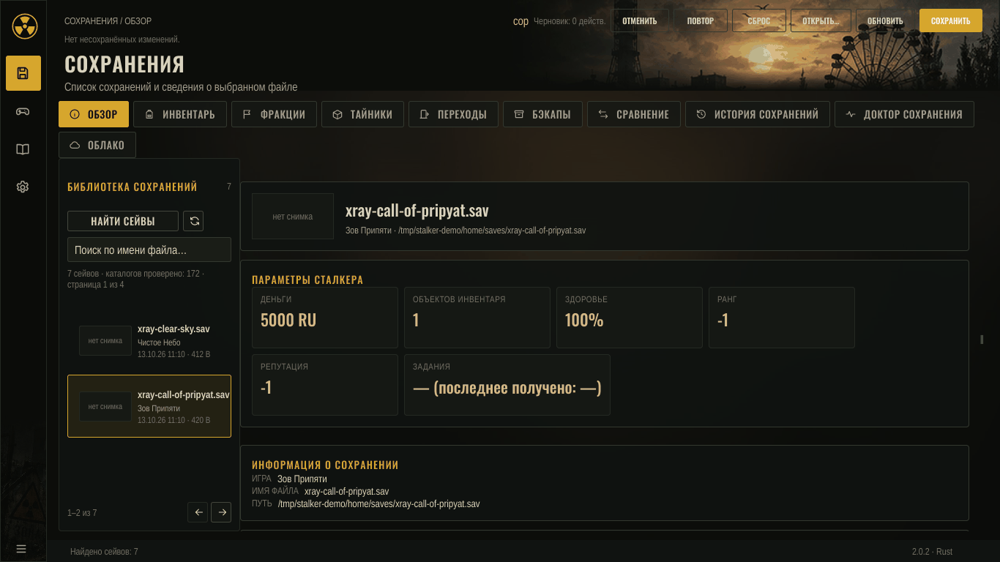

- **Левый край:** четыре раздела. Сверху вниз: **СОХРАНЕНИЯ**, **ИГРЫ**, **ЭНЦИКЛОПЕДИЯ**, **НАСТРОЙКИ**. Кнопка внизу
  сворачивает меню.
- **Вкладки под заголовком:** экраны выбранного раздела.
- **БИБЛИОТЕКА СОХРАНЕНИЙ** (на экранах раздела «Сохранения»): ваши сейвы. **НАЙТИ СЕЙВЫ** ищет заново, круглая
  стрелка обновляет список, поле ниже отбирает по имени файла, стрелки внизу листают страницы.
- **Справа вверху:** кнопки, которые действуют на открытый сейв.

| Кнопка | Что делает |
|---|---|
| **ОТМЕНИТЬ** / **ПОВТОР** | Отменяет последнюю правку в черновике или возвращает её. |
| **СБРОС** | Выбрасывает все несохранённые правки. Нажимается дважды: первое нажатие только предупреждает. |
| **ОТКРЫТЬ…** | Открывает файл сейва по пути. |
| **ОБНОВИТЬ** | Заново читает сейв с диска. |
| **СОХРАНИТЬ** | Записывает черновик в файл сейва. Сначала делается резервная копия. |

**Черновик.** Ничего из того, что вы меняете, не попадает в сейв, пока вы не нажмёте **СОХРАНИТЬ**. Правки
собираются в черновике; счётчик рядом с кнопками (**«Черновик: 2 действ.»**) показывает, сколько их. Черновик
переживает закрытие редактора: несохранённые правки будут на месте, когда вы откроете его снова.

Все двадцать экранов:

| Раздел | Экран | Для чего |
|---|---|---|
| Сохранения | **ОБЗОР** | Список сейвов и содержимое выбранного |
| Сохранения | **ИНВЕНТАРЬ** | Деньги, предметы, прочность, размещение, модификации, добавление и удаление предметов |
| Сохранения | **ФРАКЦИИ** | Отношения с группировками |
| Сохранения | **ТАЙНИКИ** | Предметы в тайниках; перенос в рюкзак |
| Сохранения | **ПЕРЕХОДЫ** | Перемещение персонажа на другую локацию |
| Сохранения | **БЭКАПЫ** | Резервные копии и возврат оригинала |
| Сохранения | **СРАВНЕНИЕ** | Чем отличаются два сейва |
| Сохранения | **ИСТОРИЯ СОХРАНЕНИЙ** | Ваши сейвы по времени |
| Сохранения | **ДОКТОР СОХРАНЕНИЯ** | Проверяет, что сейв читается, и ищет проблемы |
| Сохранения | **ОБЛАКО** | Файлы Steam Cloud |
| Игры | **ОБЗОР ИГР** | Установленные игры, найденные на этом компьютере |
| Игры | **ИСПРАВЛЕНИЯ ИГРЫ** | Исправления ошибок в файлах игры |
| Игры | **ДОКТОР ИГРЫ** | Проверяет файлы и скрипты игры |
| Игры | **СРЕДА ИГРЫ** | Снимки и профили того, что редактор изменил в игре |
| Игры | **КОМПАНЬОН** | Необязательный мод внутри игры |
| Игры | **ДОСТИЖЕНИЯ** | Достижения Steam выбранной игры |
| Энциклопедия | **ЭНЦИКЛОПЕДИЯ** | Предметы установленной игры |
| Настройки | **ВОЗМОЖНОСТИ** | Что можно править в каждой игре |
| Настройки | **ОБНОВЛЕНИЯ** | Проверка новой версии |
| Настройки | **НАСТРОЙКИ** | Язык, внешний вид, звук, папки, отчёты |

## 4. Обзор

Щёлкните по сейву в библиотеке. Справа появится:

- **ПАРАМЕТРЫ СТАЛКЕРА**: деньги, число предметов, здоровье, ранг, репутация, задания. Редактор показывает только то,
  что надёжно читается из этого сейва, поэтому некоторых значений может не быть.
- **ИНФОРМАЦИЯ О СОХРАНЕНИИ**: игра, имя файла и где он лежит.
- **ЦЕЛОСТНОСТЬ И МЕТАДАННЫЕ**: размер файла, дата, контрольные суммы. Они нужны, только если вы сообщаете о проблеме.

На этом экране ничего не правится.

## 5. Инвентарь

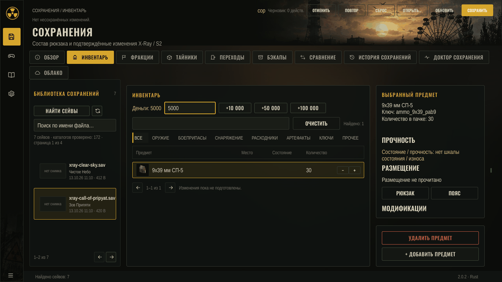

**Деньги.** Впишите число в поле **«Деньги»** или нажмите **+10 000**, **+50 000**, **+100 000**.

**Найти предмет.** Впишите часть названия в поле поиска (**ОЧИСТИТЬ** стирает его) или выберите группу: **ВСЕ**,
**ОРУЖИЕ**, **БОЕПРИПАСЫ**, **СНАРЯЖЕНИЕ**, **РАСХОДНИКИ**, **АРТЕФАКТЫ**, **КЛЮЧИ**, **ПРОЧЕЕ**.

**Патроны и другие пачки.** Кнопки **−** и **+** в строке меняют количество.

**Щёлкните по предмету**, и справа, в блоке **ВЫБРАННЫЙ ПРЕДМЕТ**, появится:

- **ПРОЧНОСТЬ**: кнопки **100%**, **75%**, **50%** задают состояние оружия или брони. У предметов без состояния
  (патроны, еда) написано «нет шкалы состояния / износа».
- **РАЗМЕЩЕНИЕ**: **РЮКЗАК**, **ПОЯС** или кнопка слота перекладывают предмет. Кнопки появляются только для тех
  перемещений, которые редактор может безопасно сделать в этом сейве.
- **МОДИФИКАЦИИ**: установленные улучшения предмета — там, где они есть в игре.
- **УДАЛИТЬ ПРЕДМЕТ** убирает предмет из сейва.

Когда закончили, нажмите **СОХРАНИТЬ** справа вверху. Строка под списком говорит, что ждёт в черновике.

Что работает в какой игре — в разделе [«Известные ограничения»](#20-известные-ограничения) и в таблице в
[README](../README.md#what-you-can-change-game-by-game).

## 6. Добавление предмета

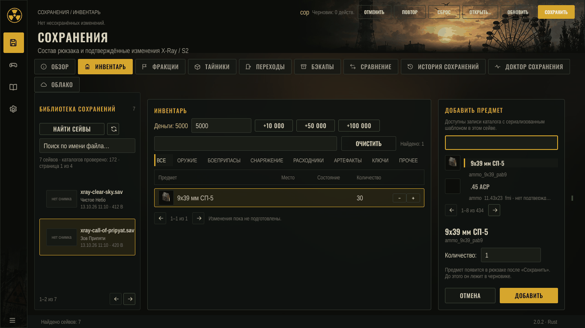

1. На экране **ИНВЕНТАРЬ** нажмите **+ ДОБАВИТЬ ПРЕДМЕТ**.
2. В поле блока **ДОБАВИТЬ ПРЕДМЕТ** впишите часть названия и щёлкните по предмету в списке.
3. Укажите **«Количество»**.
4. Нажмите **ДОБАВИТЬ**. Предмет попадает в черновик.
5. Нажмите **СОХРАНИТЬ**. Предмет появится в рюкзаке.

Редактор добавляет предмет, копируя образец такого же вида, который уже есть в вашем сейве. У предметов с пометкой
**«нет подтверждённого шаблона в сейве»** такого образца нет, и в этот сейв их добавить нельзя. Простой способ это
обойти: в игре подберите или купите один такой предмет, сохранитесь и откройте этот сейв.

В S.T.A.L.K.E.R. 2 добавлять предметы нельзя.

## 7. Фракции и переходы

### Фракции

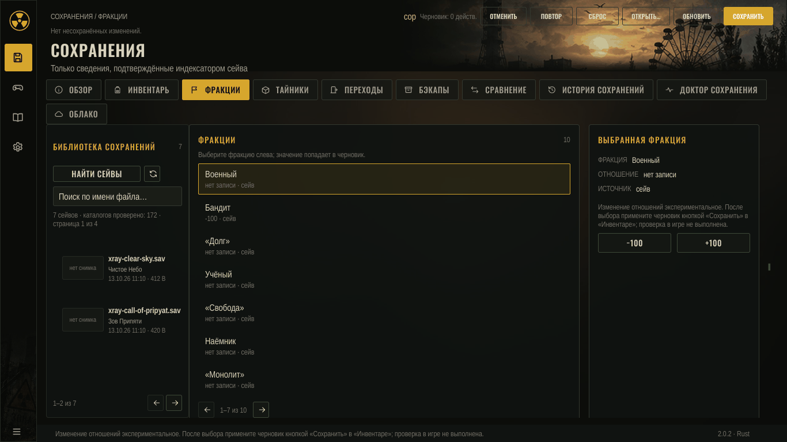

В списке — группировки игры и ваше отношение с каждой, если оно записано в сейве. Щёлкните по группировке и нажмите
справа **−100** или **+100**, затем **СОХРАНИТЬ**. Эта правка экспериментальная: в игре её ещё не загружали.

В Enhanced Edition и в S.T.A.L.K.E.R. 2 отношения не правятся.

### Переходы

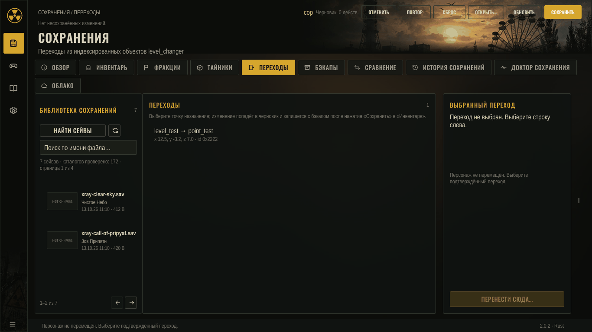

Переход — это проход с одной локации на другую, который есть в вашем сейве. Выбрав его, вы переносите персонажа
туда, куда этот проход ведёт.

1. Щёлкните по переходу в списке.
2. Нажмите **ПЕРЕНЕСТИ СЮДА…**, затем **«Подтвердить перенос»**.
3. Нажмите **СОХРАНИТЬ**.

Работает для «Тени Чернобыля», «Чистого неба» и «Зова Припяти» (не для Enhanced Edition). Правка экспериментальная:
в игре её ещё не загружали.

## 8. Тайники

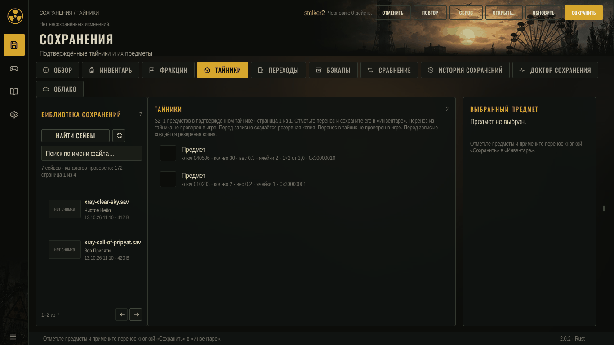

На экране — предметы из тайников, которые редактор смог надёжно прочитать.

- **«Тень Чернобыля», «Зов Припяти»:** щёлкните по предмету и нажмите **«В рюкзак»**. **«Отменить перенос»** возвращает
  его, пока он ещё в черновике. После **СОХРАНИТЬ** предмет окажется в рюкзаке. Вернуть этот предмет в тайник редактор
  не сможет, пока игра сама хотя бы раз не сохранится с ним.
- **S.T.A.L.K.E.R. 2:** **«Перенести»** перекладывает выбранный предмет из тайника в рюкзак, **«Перенести всё»** —
  всё, что помещается. **В ТАЙНИК** и **«Перенести всё в тайник»** переносят в обратную сторону. После переноса
  редактор сообщает, сколько предметов перенесено и сколько пропущено.
- **«Чистое небо» и Enhanced Edition:** перенос из тайников недоступен.

Все переносы из тайников экспериментальные: в игре их ещё не загружали.

## 9. Резервные копии, история и сравнение

### Бэкапы: как вернуть оригинал

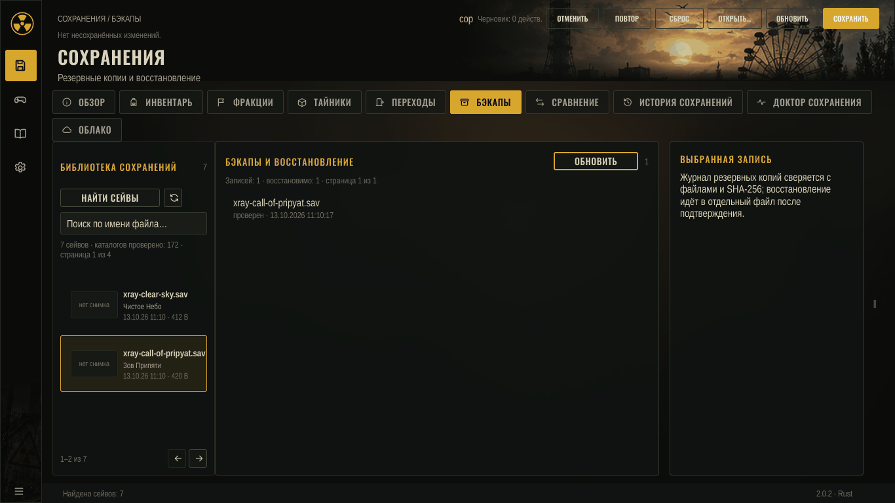

Каждый раз, когда вы нажимаете **СОХРАНИТЬ**, редактор сначала копирует исходный сейв в папку резервных копий. Чтобы
к нему вернуться:

1. Откройте **БЭКАПЫ** и нажмите **ОБНОВИТЬ**.
2. Щёлкните по записи. Её состояние должно быть **«проверен»**.
3. Выберите **«На место…»**, чтобы вернуть оригинал туда, где лежал сейв, или **«В копию…»**, чтобы записать его рядом
   под другим именем.
4. Нажмите **«Подтвердить восстановление»**.

Перед восстановлением на место редактор делает ещё одну страховочную копию файла, который собирается заменить.

Файлы копий лежат в `%LOCALAPPDATA%\StalkerSaveEditor\backups` в Windows и в
`~/.local/share/StalkerSaveEditor/backups` в Linux и macOS. Оригинал в этой папке — файл, имя которого кончается на
`_ORIGINAL.sav`. Другую папку можно выбрать в **НАСТРОЙКИ → НАСТРОЙКИ → БЭКАПЫ → ОБЗОР…**; после этого
нажмите **СОХРАНИТЬ НАСТРОЙКИ**.

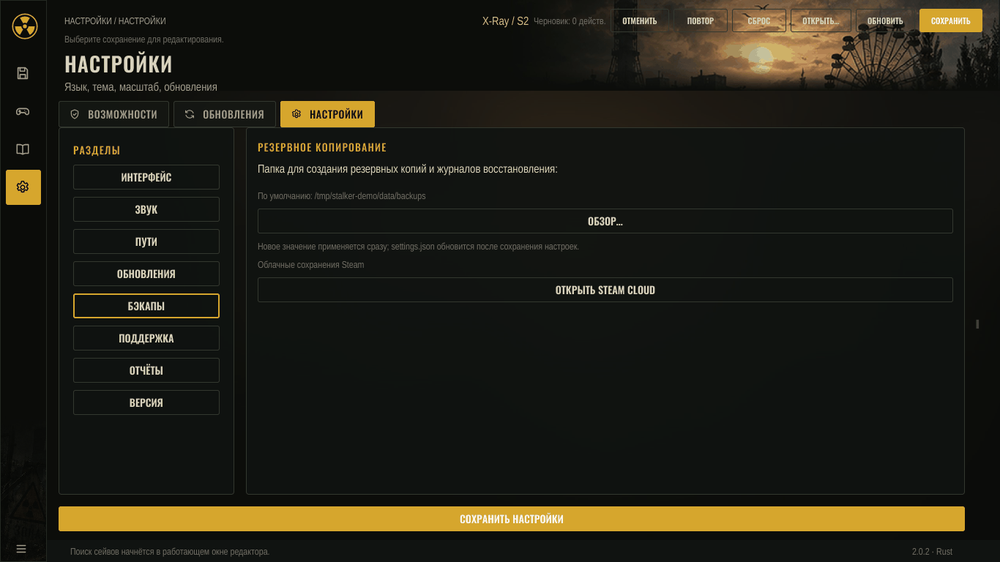

Если редактор закрыли или пропало питание посреди записи, при следующем запуске он сам откроет этот экран, чтобы вы
завершили восстановление.

### История сохранений

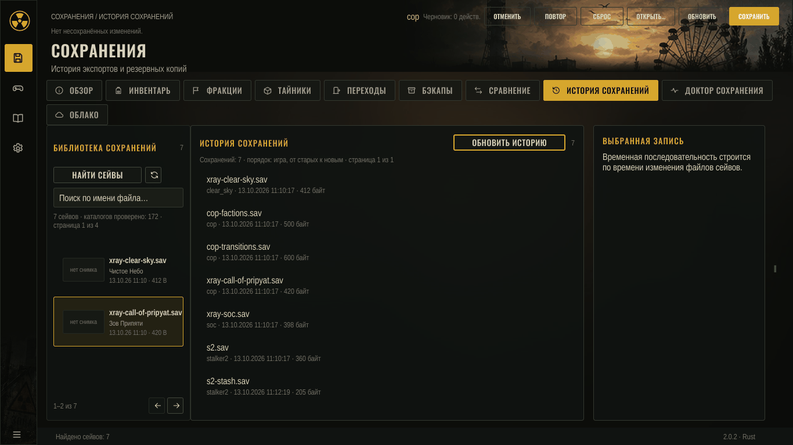

**ОБНОВИТЬ ИСТОРИЮ** показывает ваши сейвы от старых к новым по времени изменения файлов, с игрой и размером каждого.
Так быстро находится «сейв перед последним».

### Сравнение

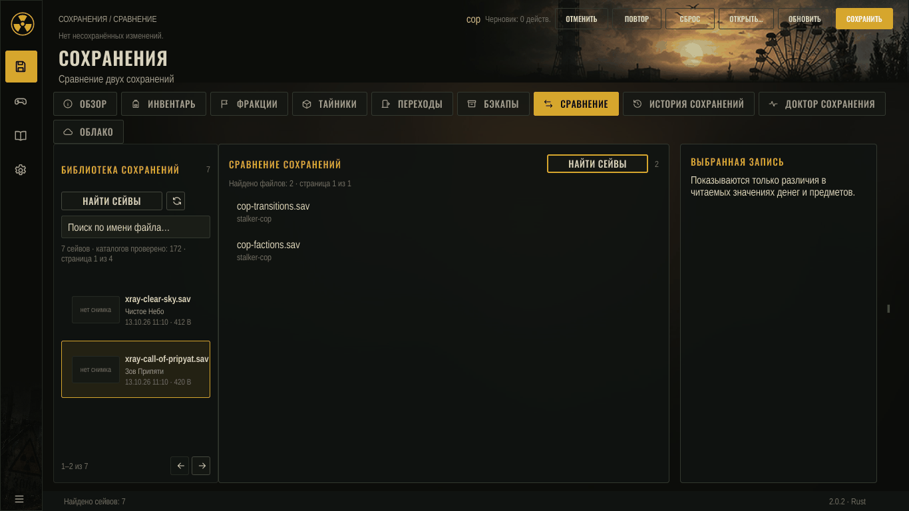

Откройте сейв, перейдите на **СРАВНЕНИЕ** и нажмите **НАЙТИ СЕЙВЫ**: в списке появятся другие сейвы той же игры.
Щёлкните по одному — справа будет видно, чем он отличается от открытого по деньгам и предметам (добавлено, удалено,
изменено). Если сейв не открыт, щёлкните по двум сейвам одной игры по очереди. Сейвы разных игр не сравниваются.

## 10. Обзор игр

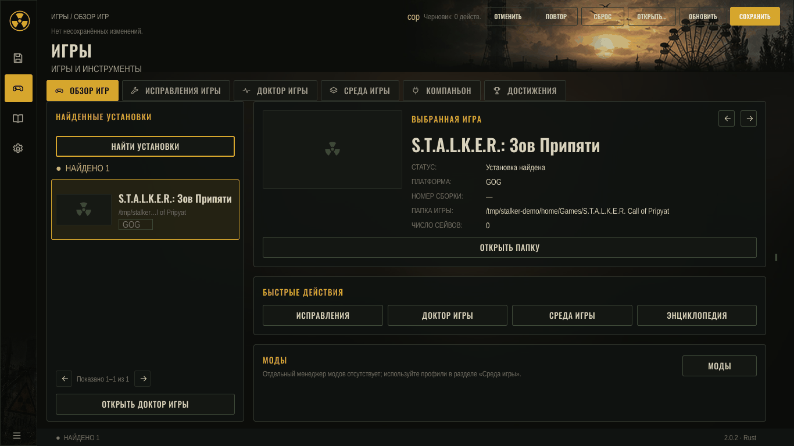

Откройте раздел **ИГРЫ**. **НАЙТИ УСТАНОВКИ** ищет установленные игры (Steam, GOG, Heroic и обычные папки с играми).
Щёлкните по найденной игре: справа видны её платформа, номер сборки, папка и число сейвов. Стрелки справа вверху
переключают игры.

- **ОТКРЫТЬ ПАПКУ** открывает папку игры.
- **БЫСТРЫЕ ДЕЙСТВИЯ** ведут на другие экраны для этой игры: **ИСПРАВЛЕНИЯ**, **ДОКТОР ИГРЫ**, **СРЕДА ИГРЫ**,
  **ЭНЦИКЛОПЕДИЯ**.

С игрой, выбранной здесь, работают экраны исправлений, доктора, среды, компаньона и достижений. Если ваша игра не
нашлась, укажите её папку вручную на экране **КОМПАНЬОН**, в блоке **ПАПКА ИГРЫ (РУЧНОЙ ВЫБОР)**.

## 11. Исправления игр

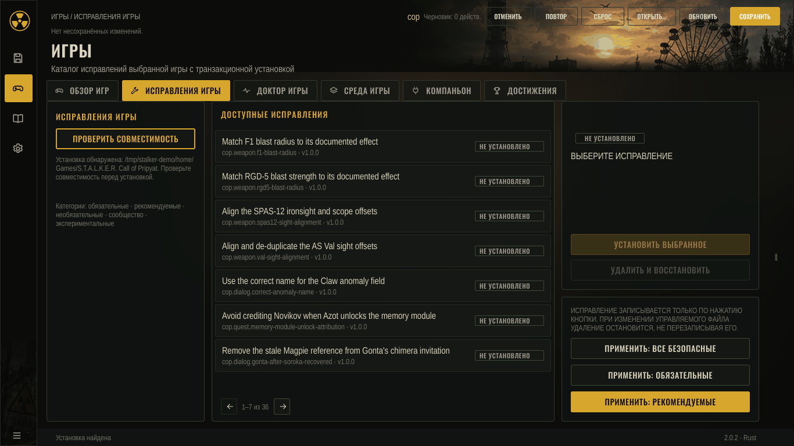

Исправления чинят известные ошибки в файлах игр: неверные значения оружия, сломанные реплики, квесты, которые нельзя
закончить. Они есть для «Тени Чернобыля», «Чистого неба», «Зова Припяти» и их Enhanced Edition; для S.T.A.L.K.E.R. 2
их нет. Названия исправлений написаны по-английски на любом языке интерфейса.

**Как поставить исправление:**

1. Закройте игру. Выберите её на экране [ОБЗОР ИГР](#10-обзор-игр).
2. Откройте **ИСПРАВЛЕНИЯ ИГРЫ** и нажмите **ПРОВЕРИТЬ СОВМЕСТИМОСТЬ**. Редактор сравнит файлы игры с теми, на которые
   рассчитано каждое исправление.
3. Щёлкните по исправлению, чтобы прочитать, что оно делает, затем нажмите **УСТАНОВИТЬ ВЫБРАННОЕ** и **ПОДТВЕРДИТЬ**.

Или поставьте набор сразу: **ПРИМЕНИТЬ: ОБЯЗАТЕЛЬНЫЕ**, **ПРИМЕНИТЬ: РЕКОМЕНДУЕМЫЕ** или **ПРИМЕНИТЬ: ВСЕ БЕЗОПАСНЫЕ**.

**Как снять исправление:** щёлкните по нему и нажмите **УДАЛИТЬ И ВОССТАНОВИТЬ**. Файл игры станет таким, каким был.
Если вы или другой мод изменили этот файл после установки исправления, редактор остановится и файл не тронет (у
исправления тогда будет состояние **ФАЙЛ ИЗМЕНЁН ПОСЛЕ УСТАНОВКИ**).

Исправление ставится, только если файл игры в точности тот, для которого оно сделано; иначе редактор отказывает и
ничего не меняет. Несколько исправлений при установке скачивают один дополнительный файл.

Исправления сверены с файлами игр, но в запущенной игре их ещё не проверяли.

## 12. Компаньон в игре

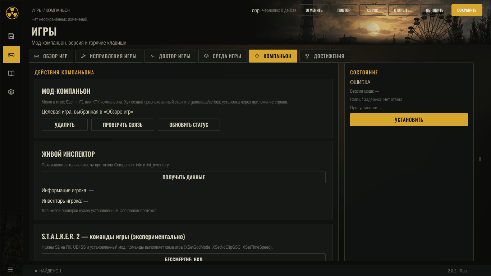

Компаньон — необязательный мод. С ним редактор может действовать на запущенную игру без перезагрузки сейва: выдать
предметы и деньги, вылечить, починить надетое, перенести в пределах локации, прочитать инвентарь.

**Как поставить:**

1. Закройте игру. Выберите её на экране [ОБЗОР ИГР](#10-обзор-игр).
2. Откройте **КОМПАНЬОН** и нажмите **УСТАНОВИТЬ**, затем **ПОДТВЕРДИТЬ**.
3. Состояние сменится на **УСТАНОВЛЕН (ОЖИДАНИЕ ИГРЫ)**. Запустите игру и загрузите сейв — станет **РАБОТАЕТ
   (ПОДКЛЮЧЁН)**. **ПРОВЕРИТЬ СВЯЗЬ** проверяет это в любой момент.

**В игре:** нажмите **Esc**, затем **F1**. Откроется меню компаньона.

**В редакторе**, пока игра запущена:

- **ЖИВОЙ ИНСПЕКТОР → ПОЛУЧИТЬ ДАННЫЕ** показывает данные игрока и инвентарь такими, какие они сейчас в игре.
- **ГОРЯЧИЕ КЛАВИШИ**: клавиши для действий **«Лечение»**, **«Ремонт экипировки»**, **«Сохранить отметку»**,
  **«Перейти к последней отметке»** и **«Быстрое сохранение»**. Задайте клавиши, нажмите **СОХРАНИТЬ КЛАВИШИ**, затем
  **ВКЛЮЧИТЬ ГОРЯЧИЕ КЛАВИШИ**. **ПО УМОЛЧАНИЮ** возвращает стандартные клавиши.
- **S.T.A.L.K.E.R. 2 — команды игры (экспериментально)**: **«Бессмертие»**, **«Полёт»**, **«Время ×5»**. Нужны версия
  игры для ПК с UE4SS и установленный мод.
- **ВСЕ ИГРЫ → УСТАНОВИТЬ / ОБНОВИТЬ ВО ВСЕ ОТМЕЧЕННЫЕ** ставит или обновляет компаньон сразу в нескольких играх.

**Как удалить:** нажмите **УДАЛИТЬ**. Редактор удалит ровно те файлы, которые поставил, и вернёт скрипт игры, который
менял.

**Enhanced Edition.** Для них компаньон должен приходить через Steam Workshop (**ПОДПИСАТЬСЯ В STEAM**). Пакеты
Workshop ещё не опубликованы, поэтому редактор пишет «Пакет Steam Workshop ещё не опубликован».

С этой версией редактора компаньон в запущенной игре ещё не проверяли.

## 13. Доктор сохранения, доктор игры и среда игры

### Доктор сохранения

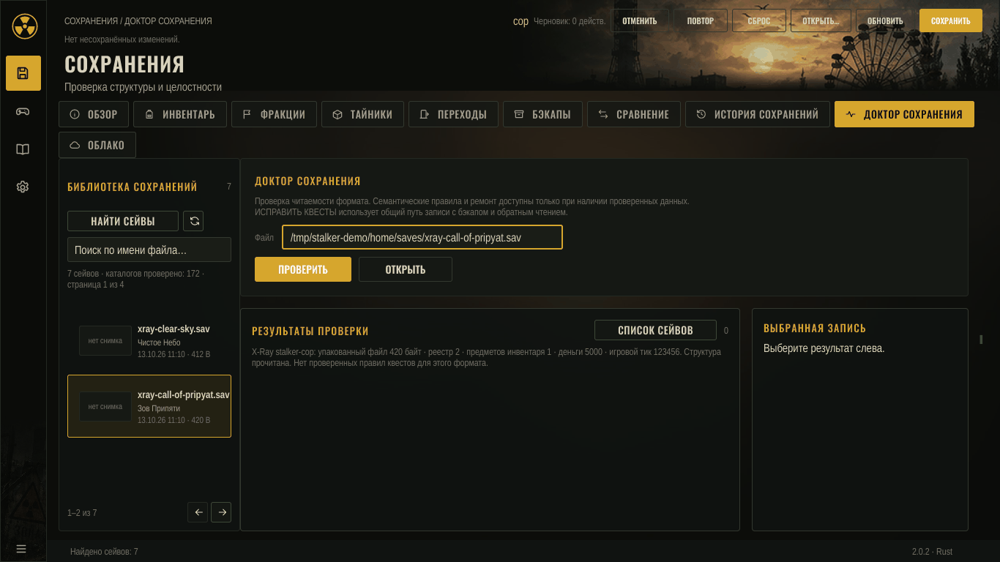

Доктор сохранения читает сейв и говорит, цела ли его структура. Открытый сейв уже вписан в поле **«Файл»**; нажмите
**ПРОВЕРИТЬ**. **СПИСОК СЕЙВОВ** показывает другие сейвы для проверки; **ОТКРЫТЬ** открывает проверенный файл в
редакторе.

Для некоторых игр доктор знает квесты, которые могут «зависнуть». Если он найдёт такой, предложит **ИСПРАВИТЬ
КВЕСТЫ** (исправление записывается как любая другая правка: с резервной копией и проверкой) или **УСТАНОВИТЬ
ИСПРАВЛЕНИЕ ИГРЫ**, если причина в файлах игры.

### Доктор игры

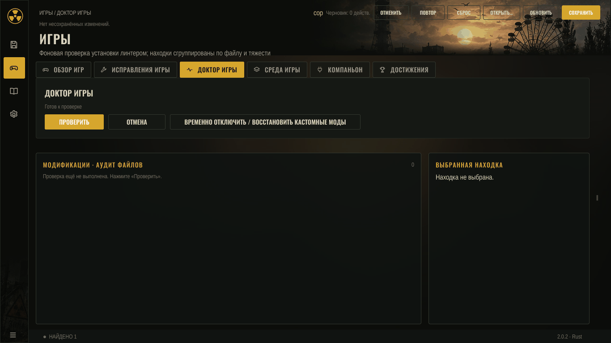

Доктор игры проверяет файлы и скрипты выбранной игры и показывает находки, сгруппированные по файлу и по
серьёзности. Нажмите **ПРОВЕРИТЬ**; **ОТМЕНА** останавливает идущую проверку. Щёлкните по находке, чтобы прочитать
подробности справа. Проверка только читает файлы.

**ВРЕМЕННО ОТКЛЮЧИТЬ / ВОССТАНОВИТЬ КАСТОМНЫЕ МОДЫ** — для S.T.A.L.K.E.R. 2: кнопка выключает ваши моды, чтобы
проверить, работает ли игра без них, и возвращает их обратно. Перед этим она спрашивает подтверждение.

### Среда игры

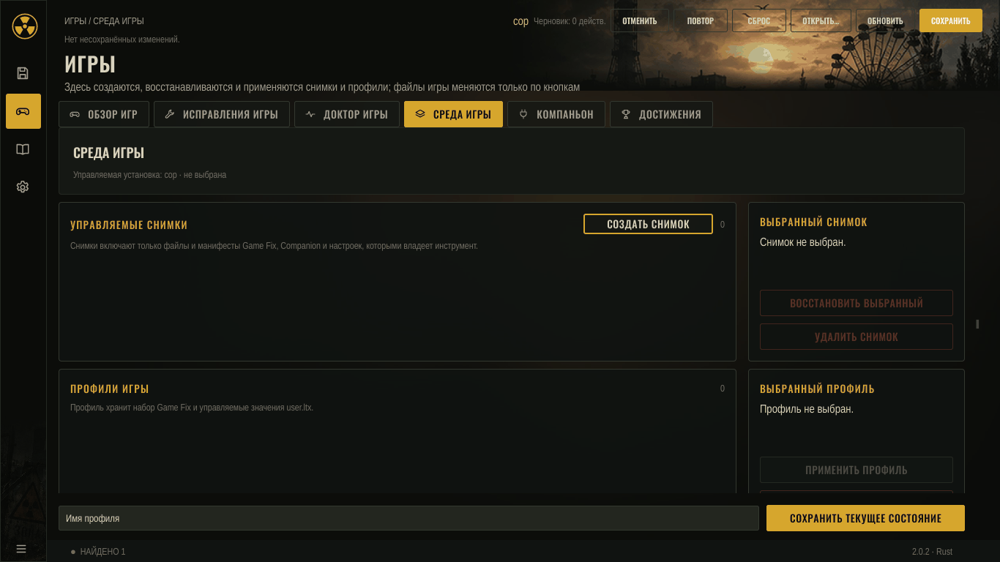

Этот экран запоминает, что сам редактор изменил в игре (исправления, компаньон, управляемые настройки), чтобы к
этому состоянию можно было вернуться.

- **УПРАВЛЯЕМЫЕ СНИМКИ**: **СОЗДАТЬ СНИМОК** запоминает текущее состояние. **ВОССТАНОВИТЬ ВЫБРАННЫЙ** возвращает к
  нему; **УДАЛИТЬ СНИМОК** убирает запись. Снимки есть только для игр на X-Ray.
- **ПРОФИЛИ ИГРЫ**: впишите **«Имя профиля»** и нажмите **СОХРАНИТЬ ТЕКУЩЕЕ СОСТОЯНИЕ**, чтобы сохранить набор
  исправлений и настроек под именем; **ПРИМЕНИТЬ ПРОФИЛЬ** переключает на него; **УДАЛИТЬ ПРОФИЛЬ** убирает его.

Снимок охватывает только то, что поставил редактор. Это не копия всей игры.

## 14. Steam Cloud и достижения

Обоим экранам нужен запущенный Steam, в который выполнен вход.

### Облако

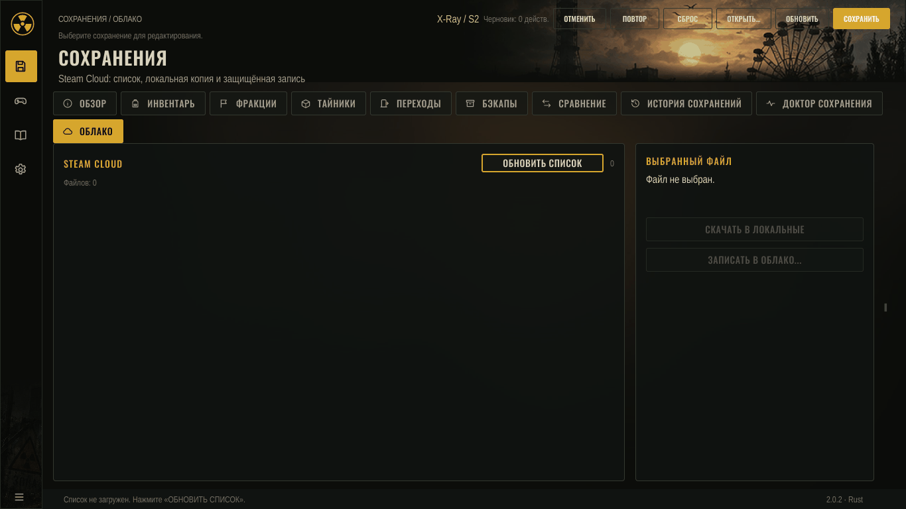

**ОБНОВИТЬ СПИСОК** показывает сейвы выбранной игры, которые лежат в Steam Cloud. Щёлкните по файлу, затем:

- **СКАЧАТЬ В ЛОКАЛЬНЫЕ** копирует его на компьютер, чтобы его можно было открыть и править.
- **ЗАПИСАТЬ В ОБЛАКО...** заменяет облачный файл вашим локальным сейвом. Редактор показывает оба файла, просит
  поставить отметку **«Я подтверждаю перезапись»**, и только после этого работает кнопка **ЗАПИСАТЬ**. Если запись в
  облако оборвалась на середине, редактор не повторяет её сам.

Запись сейвов S.T.A.L.K.E.R. 2 в Steam Cloud выключена.

### Достижения

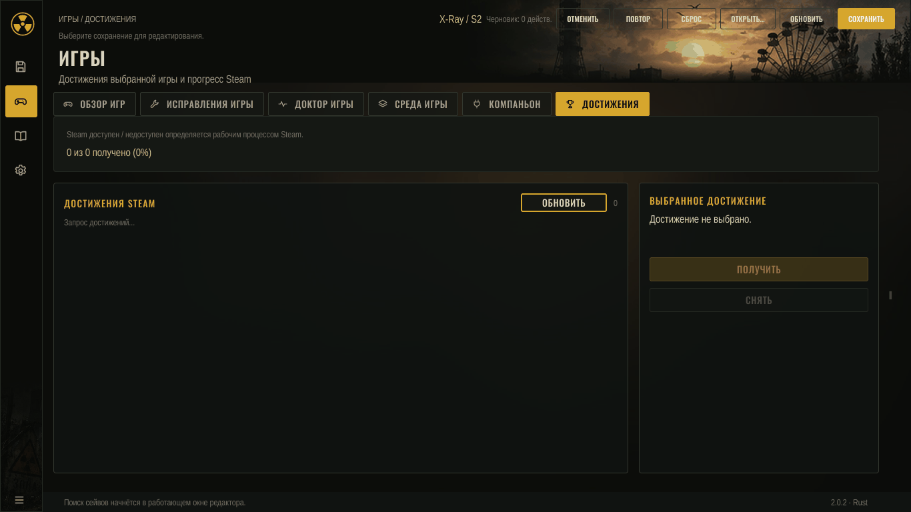

**ОБНОВИТЬ** читает достижения выбранной игры из Steam. Щёлкните по достижению и нажмите **ПОЛУЧИТЬ** или
**СНЯТЬ**; редактор попросит подтвердить. Изменение делается в вашей учётной записи Steam, а не в сейве, и оно видно
в Steam.

## 15. Энциклопедия

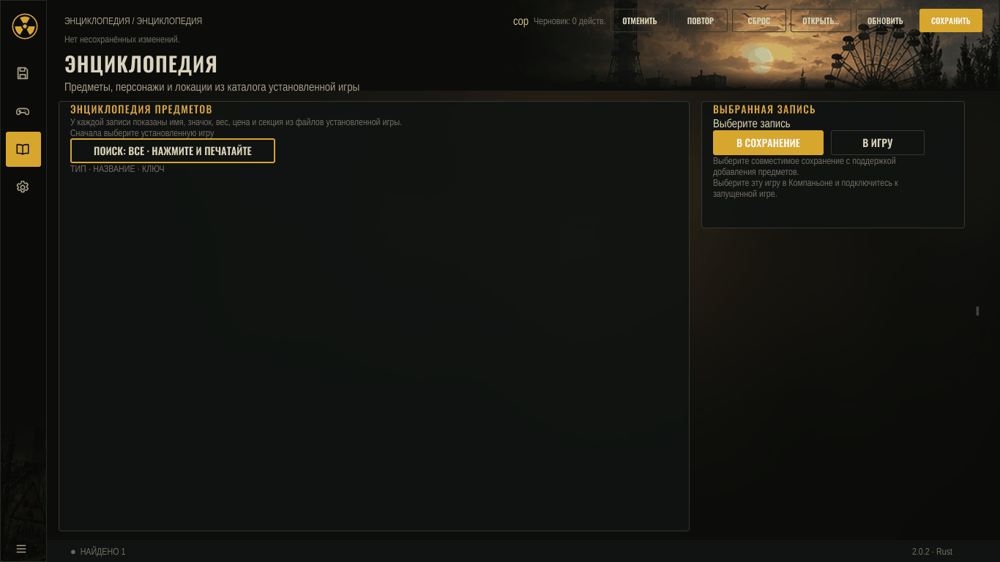

Энциклопедия показывает предметы установленной игры: названия, значки, вес и цену, прочитанные из файлов самой игры.
Сначала выберите игру на экране [ОБЗОР ИГР](#10-обзор-игр). Нажмите **ПОИСК** и печатайте, чтобы отобрать записи.

Для выбранной записи **В СОХРАНЕНИЕ** добавляет предмет в открытый сейв (правила те же, что в разделе
[«Добавление предмета»](#6-добавление-предмета)), а **В ИГРУ** выдаёт его в запущенной игре через
[компаньон](#12-компаньон-в-игре).

## 16. Обновления

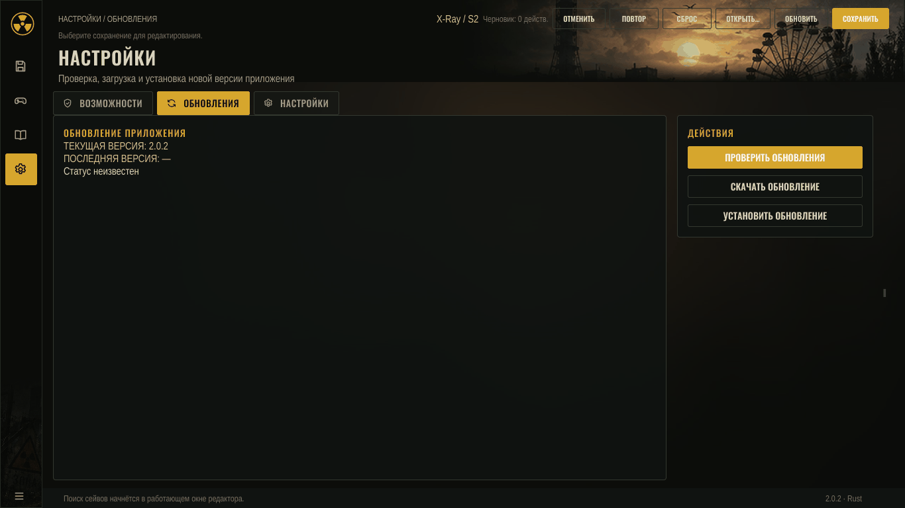

Редактор проверяет новую версию, только когда вы об этом просите.

1. **НАСТРОЙКИ → ОБНОВЛЕНИЯ → ПРОВЕРИТЬ ОБНОВЛЕНИЯ**.
2. Если обновление есть, нажмите **СКАЧАТЬ ОБНОВЛЕНИЕ**, затем **УСТАНОВИТЬ ОБНОВЛЕНИЕ**.

Перед скачиванием редактор проверяет подпись списка обновлений и отказывается от файла, который с ним не совпадает.
Версия, поставленная установщиком Windows, и версия из `.deb` ставят обновление сами (`.deb` спросит пароль); в
macOS редактор открывает скачанный образ. AppImage сам не обновляется: скачайте новый файл со страницы выпуска. Если
редактор пишет «Нет пакета для этой установки», сделайте так же.

## 17. Настройки, язык и возможности

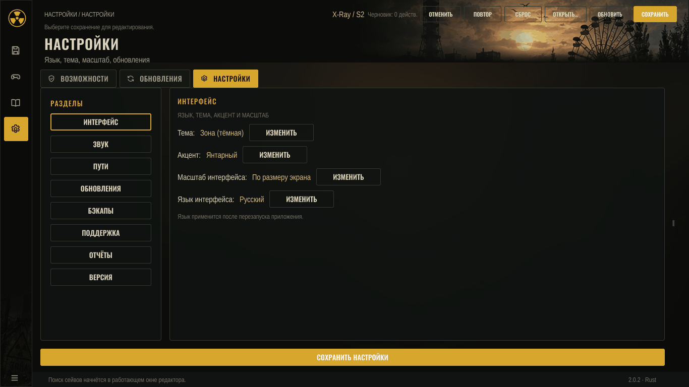

Откройте **НАСТРОЙКИ → НАСТРОЙКИ**. Выберите раздел слева, а когда закончите, нажмите **СОХРАНИТЬ НАСТРОЙКИ** внизу.

| Раздел | Что там |
|---|---|
| **ИНТЕРФЕЙС** | **Тема** («Зона (тёмная)», «Чистое небо», «День»), цвет **акцента**, **масштаб интерфейса** (по размеру экрана или 100–200 %), **язык интерфейса**. Каждая кнопка **ИЗМЕНИТЬ** переключает на следующее значение. |
| **ЗВУК** | Звуки интерфейса и музыка меню: включить, выключить, громкость. |
| **ПУТИ** | Папки, в которых редактор ищет сейвы. |
| **ОБНОВЛЕНИЯ** | Переход на экран обновлений. |
| **БЭКАПЫ** | Папка резервных копий (**ОБЗОР…**) и переход к Steam Cloud (**ОТКРЫТЬ STEAM CLOUD**). |
| **ПОДДЕРЖКА** | **«Проверить окружение»** и **«Сохранить отчёт…»** — файл, который прикладывают к сообщению об ошибке. |
| **ОТЧЁТЫ** | Отправлять ли анонимные отчёты об ошибках и отдельное согласие на статистику производительности. |
| **ВЕРСИЯ** | Версия редактора. |

**Язык.** Нажимайте **ИЗМЕНИТЬ** рядом с **«Язык интерфейса»**, пока не увидите свой, нажмите **СОХРАНИТЬ НАСТРОЙКИ** и
перезапустите редактор. Языков 15: русский, украинский, английский, немецкий, французский, итальянский, испанский,
польский, чешский, бразильский португальский, турецкий, японский, корейский, китайский упрощённый и традиционный.
Переводы не вычитаны носителями языков; для китайского, японского и корейского нужен системный шрифт с этими
знаками.

**Приватность.** Без вашего согласия ничего не отправляется. В отчётах об ошибках нет ваших сейвов, путей к файлам и
игровых логов. Отчёт, сохранённый кнопкой **«Сохранить отчёт…»**, остаётся на компьютере, пока вы сами его куда-нибудь
не приложите.

### Возможности

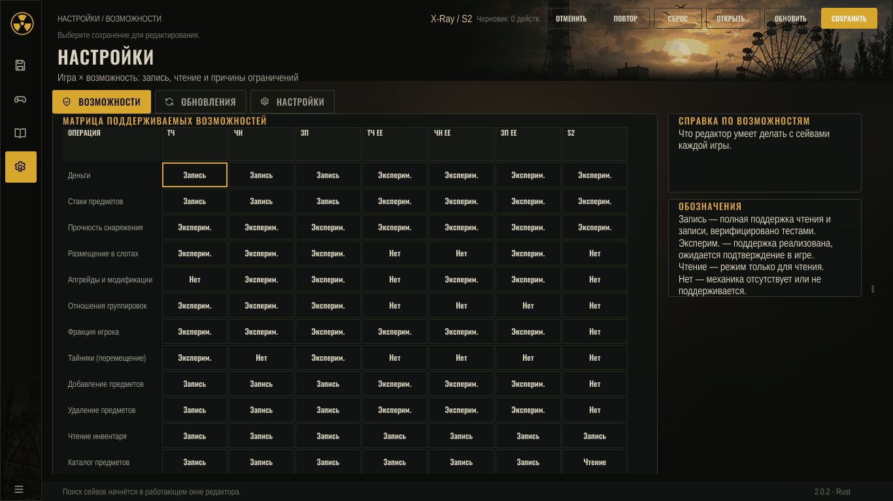

**НАСТРОЙКИ → ВОЗМОЖНОСТИ** — таблица того, что редактор умеет в каждой игре. Столбцы — игры (ТЧ, ЧН, ЗП, их Enhanced
Edition, S2), строки — виды правок.

- **Запись**: поддерживается полностью.
- **Эксперим.**: сделано, но в игре ещё не проверено.
- **Чтение**: показывается, менять нельзя.
- **Нет**: недоступно.

Щёлкните по ячейке, чтобы прочитать причину. Одна ячейка в этой версии устарела: перенос из тайников для
S.T.A.L.K.E.R. 2 помечен **«Нет»**, хотя он доступен на экране [«Тайники»](#8-тайники). Строка **«Фракция игрока»**
описывает то, что редактор умеет записать, но кнопки для этого пока нет ни на одном экране.

## 18. Версия для браузера

[stalker-save-editor.pages.dev](https://stalker-save-editor.pages.dev) — тот же редактор, работающий внутри
веб-страницы.

1. Нажмите **ОТКРЫТЬ…** и выберите файл сейва.
2. Правьте его так, как описано выше.
3. Нажмите **СОХРАНИТЬ**. Браузер скачает изменённую копию. Положите её в папку сейвов игры сами; файл, который вы
   открывали, не меняется.

Сейв читается и меняется внутри вашего браузера и никуда не загружается.

**Чем отличается от установленной программы:**

- Она не может искать сейвы на диске и писать в папку игры, поэтому открытие и сохранение делаются вручную. Файл,
  который вы открывали, остаётся на диске без изменений — это и есть ваша резервная копия: не затирайте его, пока
  игра не загрузит изменённую копию.
- Есть только экраны раздела «Сохранения», **ВОЗМОЖНОСТИ** и **НАСТРОЙКИ**. Нет раздела «Игры» (исправления,
  компаньон, доктор игры, достижения), нет Steam Cloud, энциклопедии и обновлений: страница всегда последней версии.
- Значки предметов подгружаются через мгновение после открытия страницы.

## 19. Если что-то пошло не так

**Игра не грузит изменённый сейв, или в нём что-то не так.**
Верните оригинал: [БЭКАПЫ → «На место…» → «Подтвердить восстановление»](#9-резервные-копии-история-и-сравнение).
Потом, пожалуйста, сообщите, какая это была игра и какая правка.

**Кнопка «СОХРАНИТЬ» отказывается записывать.**
- Запущена игра: закройте её и нажмите **СОХРАНИТЬ** ещё раз.
- Правка недоступна для этой игры: об этом сказано в сообщении. См. [«Известные ограничения»](#20-известные-ограничения).
- Файл сейва изменился на диске после того, как вы его открыли (например, игра сохранилась поверх): нажмите
  **ОБНОВИТЬ** и сделайте правку заново.

**Сейв не открывается.**
Редактор пишет, что файл — не сейв S.T.A.L.K.E.R. или повреждён. Подробности покажет
[ДОКТОР СОХРАНЕНИЯ](#13-доктор-сохранения-доктор-игры-и-среда-игры). Сейв сильно модифицированной игры может не
читаться.

**Редактор не находит мои сейвы или игру.**
Добавьте папку с сейвами вручную ([мастер первого запуска](#2-первый-запуск-и-поиск-сейвов) или **НАСТРОЙКИ →
ПУТИ**) либо откройте файл кнопкой **ОТКРЫТЬ…**. Для игры укажите папку в **КОМПАНЬОН → ПАПКА ИГРЫ (РУЧНОЙ ВЫБОР)**.

**Linux: окно не появляется.**
Версии до 2.0.2 не запускались в GNOME на Wayland: скачайте последний выпуск. Для AppImage проверьте, что разрешён
запуск файла как программы. Другие рабочие столы на Wayland (KDE, Sway) не проверялись.

**Windows или антивирус блокирует установщик.**
Установщик не подписан. Нажмите **«Подробнее» → «Выполнить в любом случае»**. Чтобы убедиться, что файл настоящий,
сравните его SHA-256 с файлом `.sha256`, который лежит рядом на странице выпуска.

**Как сообщить о проблеме.**
Откройте **НАСТРОЙКИ → ПОДДЕРЖКА**, нажмите **«Сохранить отчёт…»** и приложите файл к новому
[сообщению](https://github.com/Dmitriy-DE/stalker-save-editor-rs/issues). Напишите, какая игра, какая правка и что
случилось. Не прикладывайте всю папку сейвов: хватит одного сейва, на котором видна проблема.

## 20. Известные ограничения

**Не проверено в играх.** Правки «Тени Чернобыля», «Чистого неба», трёх Enhanced Edition и S.T.A.L.K.E.R. 2 в играх
не загружались; загружен один изменённый сейв «Зова Припяти». Компаньон и исправления игр в запущенной игре не
проверялись. Звук никто не слушал.

**Человек не запускал:** сборки для Windows и macOS. Образы macOS не подписаны.

**S.T.A.L.K.E.R. 2**

- Предметы нельзя добавлять и удалять.
- Модификации, размещение предметов и отношения с группировками не правятся.
- Сейвы, сделанные в игре версии 1.0.x, читаются, но не правятся: сначала загрузите и сохраните их в текущей версии
  игры.
- Записывать сейвы в Steam Cloud из редактора нельзя.

**«Тень Чернобыля», «Чистое небо», «Зов Припяти»**

- «Тень Чернобыля»: модификации не правятся.
- «Чистое небо»: предметы нельзя забрать из тайников.
- «Тень Чернобыля» и «Зов Припяти»: предмет, который редактор забрал из тайника, нельзя вернуть обратно, пока игра
  хотя бы раз не сохранится с ним.

**Enhanced Edition**

- Отношения с группировками не правятся, предметы из тайников забрать нельзя, персонажа нельзя перенести на другую
  локацию.
- «Тень Чернобыля» EE и «Чистое небо» EE: предметы нельзя перекладывать между слотами, поясом и рюкзаком.
- «Тень Чернобыля» EE: модификации не правятся.
- Пакеты компаньона для Steam Workshop ещё не опубликованы.

**Прочее**

- Кнопки для смены фракции игрока нет, хотя в таблице возможностей такая строка есть.
- Репозитория APT пока нет; `.deb` ставится вручную, а обновляется из редактора.
- Переводы не вычитаны носителями языков. Местами виден текст на другом языке (например, названия исправлений
  по-английски в русском интерфейсе).

Полная таблица — в [CAPABILITIES.md](CAPABILITIES.md) (на английском); заметки о выпусках —
[2.0.0](RELEASE_NOTES_2.0.0.md), [2.0.1](RELEASE_NOTES_2.0.1.md) и [2.0.2](RELEASE_NOTES_2.0.2.md).

*Это неофициальный фанатский проект. Он не создан, не одобрен и не поддерживается GSC Game World.*
