# S.T.A.L.K.E.R. Save Editor: посібник користувача

*Іншими мовами: [English](GUIDE.md) · [Русский](GUIDE.ru.md)*

Цей посібник для гравців. У ньому — як встановити редактор, відкрити збереження, змінити його та повернути
оригінал, і що є на кожному екрані програми. Назви кнопок написано точно так, як в українському інтерфейсі.

**Що варто знати заздалегідь.** Перед кожною зміною редактор робить резервну копію. У грі поки що завантажено лише
одне змінене збереження «Поклику Прип'яті»; усе інше редактор перевіряє сам, але в іграх це не перевіряли. Збірки для
Windows і macOS людина ще не запускала. Не видаляйте резервні копії, а якщо гра не завантажує збереження —
[поверніть оригінал](#9-резервні-копії-історія-та-порівняння).

Знімки екрана зроблено в програмі на маленьких тестових збереженнях, тому списки на них короткі.

## Зміст

1. [Встановлення](#1-встановлення)
2. [Перший запуск і пошук збережень](#2-перший-запуск-і-пошук-збережень)
3. [Вікно програми](#3-вікно-програми)
4. [Огляд](#4-огляд)
5. [Інвентар](#5-інвентар)
6. [Додавання предмета](#6-додавання-предмета)
7. [Фракції та переходи](#7-фракції-та-переходи)
8. [Схованки](#8-схованки)
9. [Резервні копії, історія та порівняння](#9-резервні-копії-історія-та-порівняння)
10. [Огляд ігор](#10-огляд-ігор)
11. [Виправлення ігор](#11-виправлення-ігор)
12. [Компаньйон у грі](#12-компаньйон-у-грі)
13. [Діагностика збереження, діагностика гри та середовище гри](#13-діагностика-збереження-діагностика-гри-та-середовище-гри)
14. [Steam Cloud і досягнення](#14-steam-cloud-і-досягнення)
15. [Енциклопедія](#15-енциклопедія)
16. [Оновлення](#16-оновлення)
17. [Налаштування, мова та можливості](#17-налаштування-мова-та-можливості)
18. [Версія для браузера](#18-версія-для-браузера)
19. [Якщо щось пішло не так](#19-якщо-щось-пішло-не-так)
20. [Відомі обмеження](#20-відомі-обмеження)

## 1. Встановлення

Усі файли лежать на [сторінці останнього випуску](https://github.com/Dmitriy-DE/stalker-save-editor-rs/releases/latest).

### Windows

1. Завантажте [SaveEditor-windows-x86_64-setup.exe](https://github.com/Dmitriy-DE/stalker-save-editor-rs/releases/latest/download/SaveEditor-windows-x86_64-setup.exe)
   і запустіть.
2. Windows покаже вікно про захист комп'ютера (**Windows protected your PC**). Так і має бути: інсталятор не
   підписано платним сертифікатом. Натисніть **«Докладніше»** (More info), потім **«Усе одно запустити»** (Run anyway).
3. Пройдіть встановлення. Наприкінці інсталятор запропонує запустити редактор; надалі він є в меню «Пуск» під назвою
   **S.T.A.L.K.E.R. Save Editor**.

Якщо нічого встановлювати не хочеться, завантажте
[SaveEditor-windows-x86_64.zip](https://github.com/Dmitriy-DE/stalker-save-editor-rs/releases/latest/download/SaveEditor-windows-x86_64.zip),
розпакуйте в будь-яку теку та запустіть `sse-shell.exe`.

### Linux

**AppImage (будь-який дистрибутив).**

1. Завантажте [SaveEditor-linux-x86_64.AppImage](https://github.com/Dmitriy-DE/stalker-save-editor-rs/releases/latest/download/SaveEditor-linux-x86_64.AppImage).
2. Клацніть файл правою кнопкою → **«Властивості»** → дозвольте запускати його як програму.
3. Відкрийте файл подвійним клацанням.

AppImage сам не оновлюється: для нової версії завантажте новий файл.

**Ubuntu, Debian, Linux Mint (.deb).**

1. На [сторінці випуску](https://github.com/Dmitriy-DE/stalker-save-editor-rs/releases/latest) завантажте
   `stalker-save-editor_<версія>_amd64.deb`.
2. Відкрийте його подвійним клацанням. Відкриється центр застосунків; натисніть **«Встановити»** і введіть пароль.
3. Знайдіть **S.T.A.L.K.E.R. Save Editor** у меню застосунків.

Якщо подвійне клацання не відкриває встановлення, відкрийте термінал у теці завантажень і виконайте
`sudo apt install ./stalker-save-editor_*_amd64.deb`.

**Звичайний архів.** [SaveEditor-linux-x86_64.tar.gz](https://github.com/Dmitriy-DE/stalker-save-editor-rs/releases/latest/download/SaveEditor-linux-x86_64.tar.gz):
розпакуйте та запустіть `sse-shell`.

> Версії до 2.0.2 не запускалися в GNOME на Wayland (звичайна стільниця нинішньої Ubuntu): вікно не з'являлося.
> Якщо у вас так, завантажте останній випуск. Інші стільниці на Wayland (KDE, Sway) не перевіряли; якщо вікно не
> з'являється там, користуйтеся [версією для браузера](#18-версія-для-браузера) та
> [повідомте нас](#19-якщо-щось-пішло-не-так).

### macOS

1. Завантажте образ для свого Mac:
   [процесор Apple (M1 і новіші)](https://github.com/Dmitriy-DE/stalker-save-editor-rs/releases/latest/download/SaveEditor-macos-arm64.dmg)
   або [Intel](https://github.com/Dmitriy-DE/stalker-save-editor-rs/releases/latest/download/SaveEditor-macos-x86_64.dmg).
2. Відкрийте образ і перетягніть **SaveEditor** до теки «Програми».
3. Першого разу клацніть **SaveEditor** правою кнопкою → **«Відкрити»** → **«Відкрити»**. Образ не підписано Apple,
   тому звичайне подвійне клацання не спрацює. У нових версіях macOS той самий дозвіл надається в системних
   параметрах, у розділі приватності й безпеки (**Privacy & Security → Open Anyway**).

Потрібна macOS 11 або новіша. Збірку для macOS людина ще не запускала; якщо вона поводиться неправильно,
[повідомте про це](#19-якщо-щось-пішло-не-так).

### Нічого не встановлювати

Відкрийте [stalker-save-editor.pages.dev](https://stalker-save-editor.pages.dev). Докладніше — у розділі
[«Версія для браузера»](#18-версія-для-браузера).

## 2. Перший запуск і пошук збережень

Редактор запускається мовою вашої системи (мову можна [змінити](#17-налаштування-мова-та-можливості)). Під час
першого запуску він спитає, чи можна надсилати анонімні звіти про помилки: відповідайте **«Так»** або **«Ні»**,
підійде будь-яка відповідь.

Далі він шукає збереження у звичайних теках ігор. Знайдені збереження з'являються ліворуч, у **БІБЛІОТЕЦІ
ЗБЕРЕЖЕНЬ**. Якщо нічого не знайдено, відкривається **МАЙСТЕР ПЕРШОГО ЗАПУСКУ**:

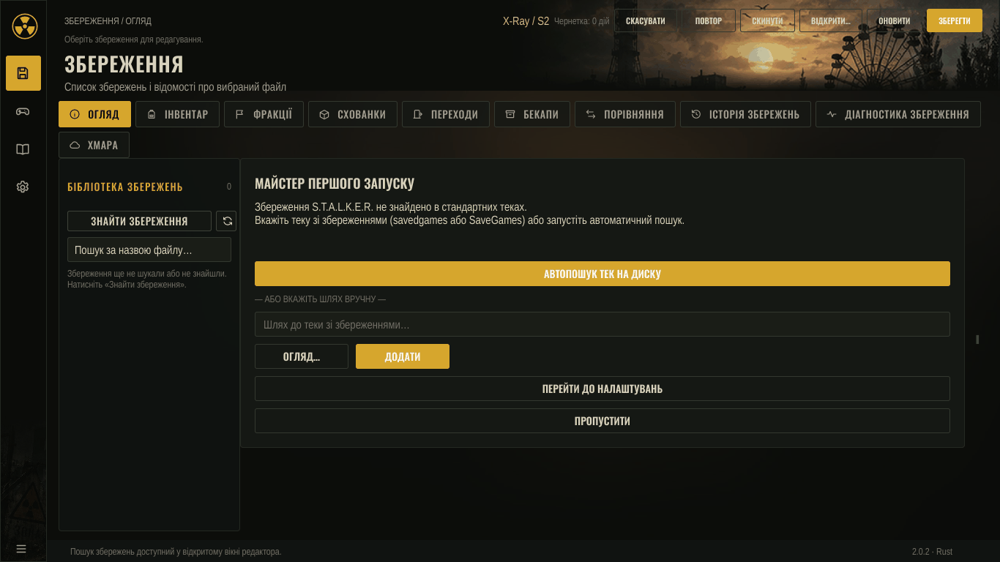

- **АВТОПОШУК ТЕК НА ДИСКУ** шукає теки зі збереженнями на диску.
- Або впишіть шлях до теки зі збереженнями (зазвичай вона називається `savedgames` або `SaveGames`) чи натисніть
  **ОГЛЯД…**, потім **ДОДАТИ**.
- **ПЕРЕЙТИ ДО НАЛАШТУВАНЬ** відкриває список тек зі збереженнями; **ПРОПУСТИТИ** закриває майстер.

Один файл завжди можна відкрити напряму: натисніть **ВІДКРИТИ…** угорі вікна, потім **«Огляд…»**, виберіть
збереження й натисніть **«Відкрити»**.

Редактор розпізнає збереження за вмістом, а не за назвою, тому перейменовані файли теж відкриваються.

## 3. Вікно програми

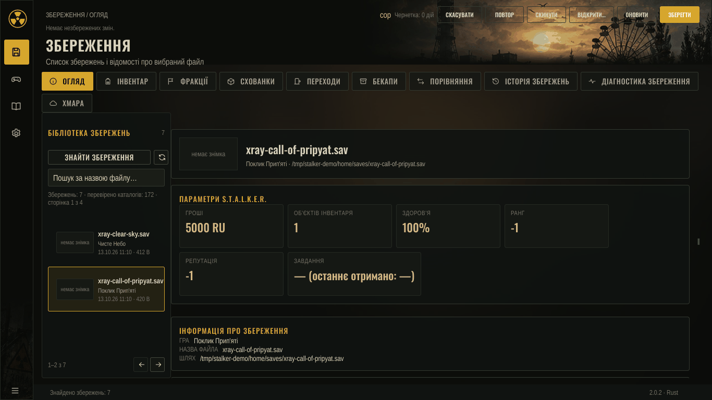

- **Лівий край:** чотири розділи. Згори донизу: **ЗБЕРЕЖЕННЯ**, **ІГРИ**, **ЕНЦИКЛОПЕДІЯ**, **НАЛАШТУВАННЯ**. Кнопка
  внизу згортає меню.
- **Вкладки під заголовком:** екрани вибраного розділу.
- **БІБЛІОТЕКА ЗБЕРЕЖЕНЬ** (на екранах розділу «Збереження»): ваші збереження. **ЗНАЙТИ ЗБЕРЕЖЕННЯ** шукає знову,
  кругла стрілка оновлює список, поле нижче відбирає за назвою файлу, стрілки внизу гортають сторінки.
- **Праворуч угорі:** кнопки, що діють на відкрите збереження.

| Кнопка | Що робить |
|---|---|
| **СКАСУВАТИ** / **ПОВТОР** | Скасовує останню зміну в чернетці або повертає її. |
| **СКИНУТИ** | Відкидає всі незбережені зміни. Натискається двічі: перше натискання лише попереджає. |
| **ВІДКРИТИ…** | Відкриває файл збереження за шляхом. |
| **ОНОВИТИ** | Знову читає збереження з диска. |
| **ЗБЕРЕГТИ** | Записує чернетку у файл збереження. Спершу робиться резервна копія. |

**Чернетка.** Ніщо з того, що ви змінюєте, не потрапляє до збереження, доки ви не натиснете **ЗБЕРЕГТИ**. Зміни
збираються в чернетці; лічильник поруч із кнопками (**«Чернетка: 2 дій»**) показує, скільки їх. Чернетка переживає
закриття редактора: незбережені зміни будуть на місці, коли ви відкриєте його знову.

Усі двадцять екранів:

| Розділ | Екран | Для чого |
|---|---|---|
| Збереження | **ОГЛЯД** | Список збережень і вміст вибраного |
| Збереження | **ІНВЕНТАР** | Гроші, предмети, міцність, розміщення, модифікації, додавання й видалення предметів |
| Збереження | **ФРАКЦІЇ** | Стосунки з угрупованнями |
| Збереження | **СХОВАНКИ** | Предмети у схованках; перенесення до рюкзака |
| Збереження | **ПЕРЕХОДИ** | Переміщення персонажа на іншу локацію |
| Збереження | **БЕКАПИ** | Резервні копії та повернення оригіналу |
| Збереження | **ПОРІВНЯННЯ** | Чим відрізняються два збереження |
| Збереження | **ІСТОРІЯ ЗБЕРЕЖЕНЬ** | Ваші збереження за часом |
| Збереження | **ДІАГНОСТИКА ЗБЕРЕЖЕННЯ** | Перевіряє, що збереження читається, і шукає проблеми |
| Збереження | **ХМАРА** | Файли Steam Cloud |
| Ігри | **ОГЛЯД ІГОР** | Встановлені ігри, знайдені на цьому комп'ютері |
| Ігри | **ВИПРАВЛЕННЯ ГРИ** | Виправлення помилок у файлах гри |
| Ігри | **ДІАГНОСТИКА ГРИ** | Перевіряє файли та скрипти гри |
| Ігри | **СЕРЕДОВИЩЕ ГРИ** | Знімки стану та профілі того, що редактор змінив у грі |
| Ігри | **КОМПАНЬЙОН** | Необов'язковий мод усередині гри |
| Ігри | **ДОСЯГНЕННЯ** | Досягнення Steam вибраної гри |
| Енциклопедія | **ЕНЦИКЛОПЕДІЯ** | Предмети встановленої гри |
| Налаштування | **МОЖЛИВОСТІ** | Що можна редагувати в кожній грі |
| Налаштування | **ОНОВЛЕННЯ** | Перевірка нової версії |
| Налаштування | **НАЛАШТУВАННЯ** | Мова, вигляд, звук, теки, звіти |

На деяких кнопках той самий екран названо інакше: **ДОКТОР ГРИ** та **ДІАГНОСТИКА ГРИ** — це один екран.

## 4. Огляд

Клацніть збереження в бібліотеці. Праворуч з'явиться:

- **ПАРАМЕТРИ S.T.A.L.K.E.R.**: гроші, кількість предметів, здоров'я, ранг, репутація, завдання. Редактор показує
  лише те, що надійно читається з цього збереження, тому деяких значень може не бути.
- **ІНФОРМАЦІЯ ПРО ЗБЕРЕЖЕННЯ**: гра, назва файлу та де він лежить.
- **ЦІЛІСНІСТЬ І МЕТАДАНІ**: розмір файлу, дата, контрольні суми. Вони потрібні, лише якщо ви повідомляєте про
  проблему.

На цьому екрані нічого не редагується.

## 5. Інвентар

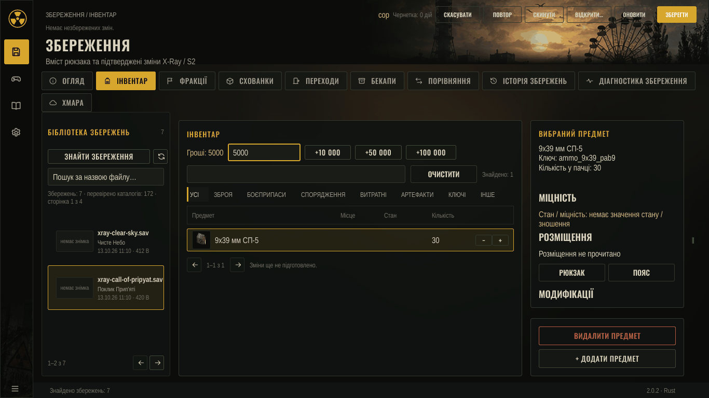

**Гроші.** Впишіть число в поле **«Гроші»** або натисніть **+10 000**, **+50 000**, **+100 000**.

**Знайти предмет.** Впишіть частину назви в поле пошуку (**ОЧИСТИТИ** стирає його) або виберіть групу: **УСІ**,
**ЗБРОЯ**, **БОЄПРИПАСИ**, **СПОРЯДЖЕННЯ**, **ВИТРАТНІ**, **АРТЕФАКТИ**, **КЛЮЧІ**, **ІНШЕ**.

**Набої та інші пачки.** Кнопки **−** і **+** у рядку змінюють кількість.

**Клацніть предмет**, і праворуч, у блоці **ВИБРАНИЙ ПРЕДМЕТ**, з'явиться:

- **МІЦНІСТЬ**: кнопки **100%**, **75%**, **50%** задають стан зброї чи броні. У предметів без стану (набої, їжа)
  написано «немає значення стану / зношення».
- **РОЗМІЩЕННЯ**: **РЮКЗАК**, **ПОЯС** або кнопка слота перекладають предмет. Кнопки з'являються лише для тих
  переміщень, які редактор може безпечно зробити в цьому збереженні.
- **МОДИФІКАЦІЇ**: встановлені покращення предмета — там, де вони є у грі.
- **ВИДАЛИТИ ПРЕДМЕТ** прибирає предмет зі збереження.

Коли закінчили, натисніть **ЗБЕРЕГТИ** праворуч угорі. Рядок під списком каже, що чекає в чернетці.

Що працює в якій грі — у розділі [«Відомі обмеження»](#20-відомі-обмеження) та в таблиці в
[README](../README.md#what-you-can-change-game-by-game).

## 6. Додавання предмета

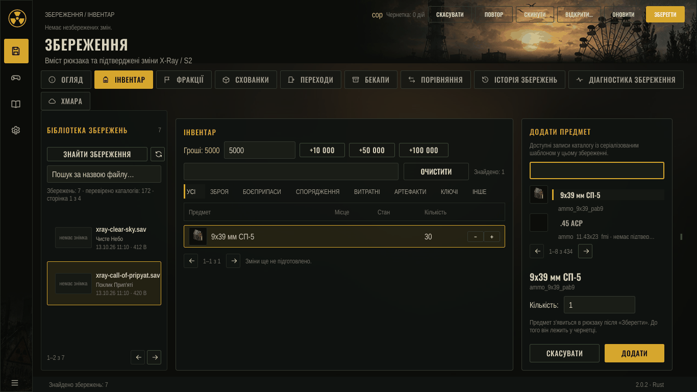

1. На екрані **ІНВЕНТАР** натисніть **+ ДОДАТИ ПРЕДМЕТ**.
2. У полі блоку **ДОДАТИ ПРЕДМЕТ** впишіть частину назви та клацніть предмет у списку.
3. Вкажіть **«Кількість»**.
4. Натисніть **ДОДАТИ**. Предмет потрапляє до чернетки.
5. Натисніть **ЗБЕРЕГТИ**. Предмет з'явиться в рюкзаку.

Редактор додає предмет, копіюючи зразок такого самого виду, який уже є у вашому збереженні. У предметів із позначкою
**«немає підтвердженого шаблону у збереженні»** такого зразка немає, і до цього збереження їх додати не можна.
Простий спосіб це обійти: у грі підберіть або купіть один такий предмет, збережіться й відкрийте це збереження.

У S.T.A.L.K.E.R. 2 додавати предмети не можна.

## 7. Фракції та переходи

### Фракції

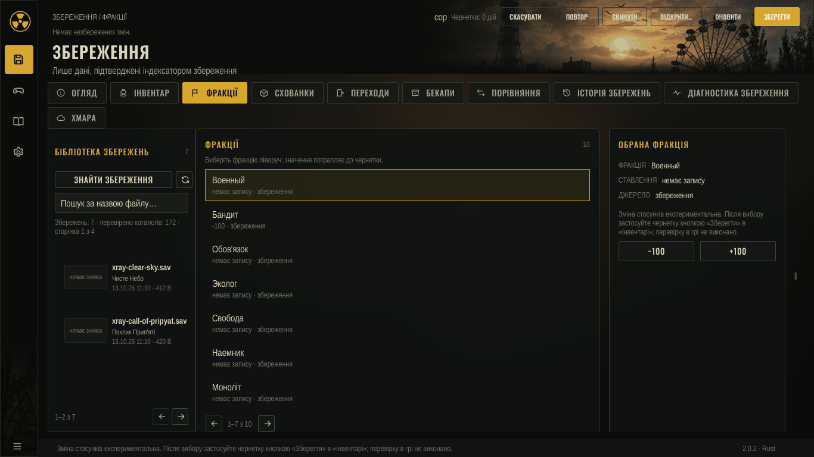

У списку — угруповання гри та ваші стосунки з кожним, якщо вони записані у збереженні. Клацніть угруповання й
натисніть праворуч **−100** або **+100**, потім **ЗБЕРЕГТИ**. Ця зміна експериментальна: у грі її ще не завантажували.

В Enhanced Edition і в S.T.A.L.K.E.R. 2 стосунки не редагуються.

### Переходи

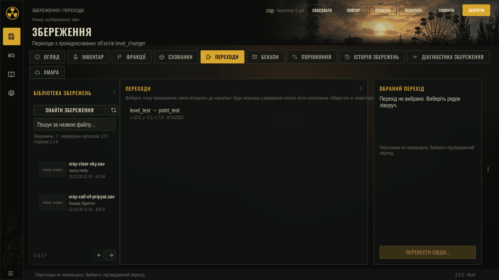

Перехід — це прохід з однієї локації на іншу, який є у вашому збереженні. Вибравши його, ви переносите персонажа
туди, куди цей прохід веде.

1. Клацніть перехід у списку.
2. Натисніть **ПЕРЕНЕСТИ СЮДИ…**, потім **«Підтвердити перенесення»**.
3. Натисніть **ЗБЕРЕГТИ**.

Працює для «Тіні Чорнобиля», «Чистого неба» та «Поклику Прип'яті» (не для Enhanced Edition). Зміна експериментальна:
у грі її ще не завантажували.

## 8. Схованки

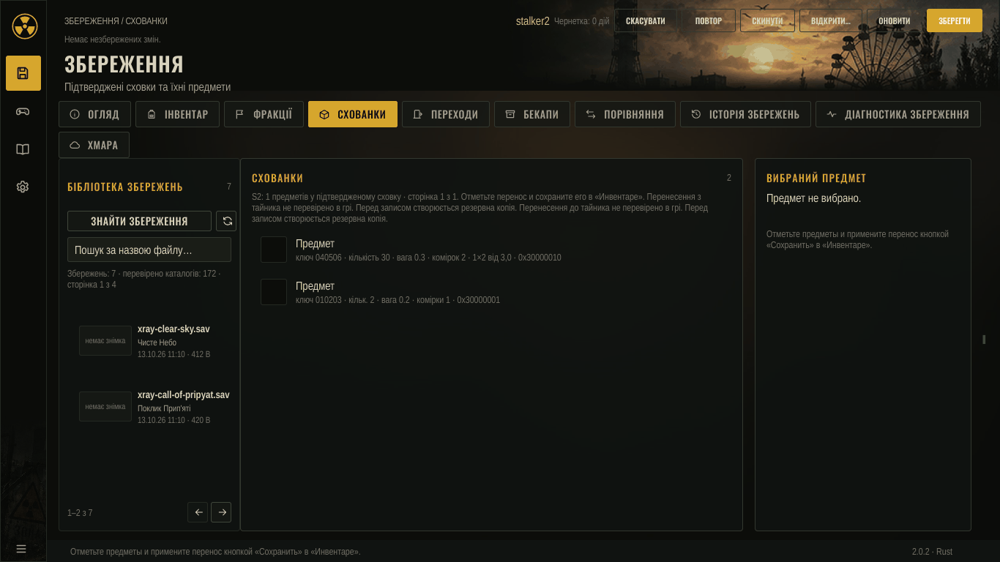

На екрані — предмети зі схованок, які редактор зміг надійно прочитати.

- **«Тінь Чорнобиля», «Поклик Прип'яті»:** клацніть предмет і натисніть **«До рюкзака»**. **«Скасувати перенесення»**
  повертає його, доки він ще в чернетці. Після **ЗБЕРЕГТИ** предмет опиниться в рюкзаку. Повернути цей предмет до
  схованки редактор не зможе, доки гра сама хоча б раз не збережеться з ним.
- **S.T.A.L.K.E.R. 2:** **«Перенести»** перекладає вибраний предмет зі схованки до рюкзака, **«Перенести все»** — усе,
  що вміщається. **У ТАЙНИК** і **«Перенести все до тайника»** переносять у зворотний бік. Після перенесення редактор
  повідомляє, скільки предметів перенесено і скільки пропущено.
- **«Чисте небо» та Enhanced Edition:** перенесення зі схованок недоступне.

Усі перенесення зі схованок експериментальні: у грі їх ще не завантажували.

## 9. Резервні копії, історія та порівняння

### Бекапи: як повернути оригінал

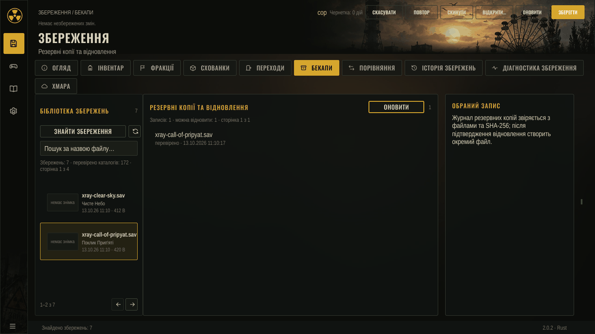

Щоразу, коли ви натискаєте **ЗБЕРЕГТИ**, редактор спершу копіює початкове збереження до теки резервних копій. Щоб до
нього повернутися:

1. Відкрийте **БЕКАПИ** й натисніть **ОНОВИТИ**.
2. Клацніть запис. Його стан має бути **«перевірено»**.
3. Виберіть **«Відновити на місце…»**, щоб повернути оригінал туди, де лежало збереження, або **«Відновити в
   копію…»**, щоб записати його поруч під іншою назвою.
4. Натисніть **«Підтвердити відновлення»**.

Перед відновленням на місце редактор робить ще одну страхувальну копію файлу, який збирається замінити.

Файли копій лежать у `%LOCALAPPDATA%\StalkerSaveEditor\backups` у Windows і в
`~/.local/share/StalkerSaveEditor/backups` у Linux та macOS. Оригінал у цій теці — файл, назва якого закінчується на
`_ORIGINAL.sav`. Іншу теку можна вибрати в **НАЛАШТУВАННЯ → НАЛАШТУВАННЯ → БЕКАПИ → ОГЛЯД…**; після цього
натисніть **ЗБЕРЕГТИ НАЛАШТУВАННЯ**.

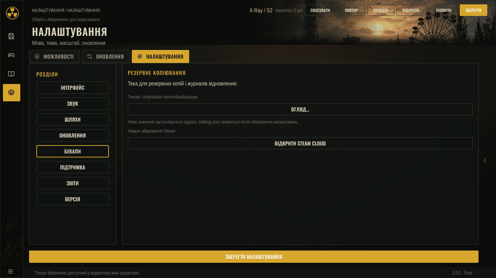

Якщо редактор закрили або зникло живлення посеред запису, під час наступного запуску він сам відкриє цей екран, щоб
ви завершили відновлення.

### Історія збережень

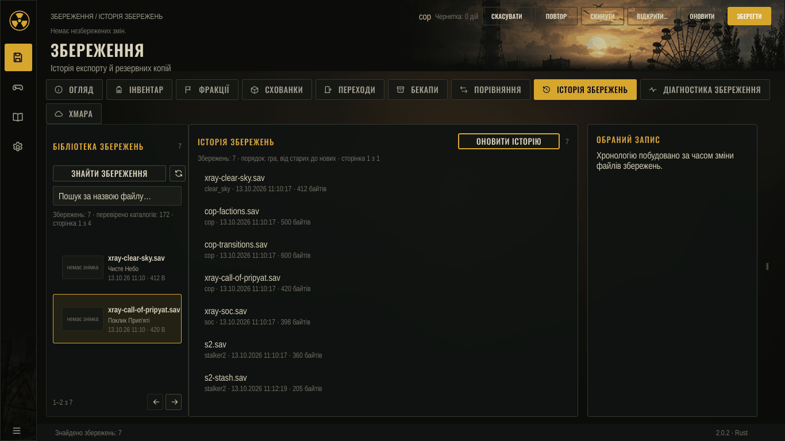

**ОНОВИТИ ІСТОРІЮ** показує ваші збереження від старих до нових за часом зміни файлів, із грою та розміром кожного.
Так швидко знаходиться «збереження перед останнім».

### Порівняння

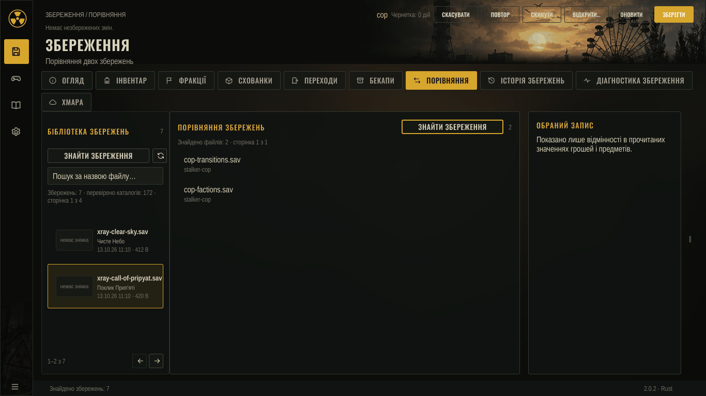

Відкрийте збереження, перейдіть на **ПОРІВНЯННЯ** й натисніть **ЗНАЙТИ ЗБЕРЕЖЕННЯ**: у списку з'являться інші
збереження тієї самої гри. Клацніть одне — праворуч буде видно, чим воно відрізняється від відкритого за грошима та
предметами (додано, видалено, змінено). Якщо збереження не відкрито, клацніть два збереження однієї гри по черзі.
Збереження різних ігор не порівнюються.

## 10. Огляд ігор

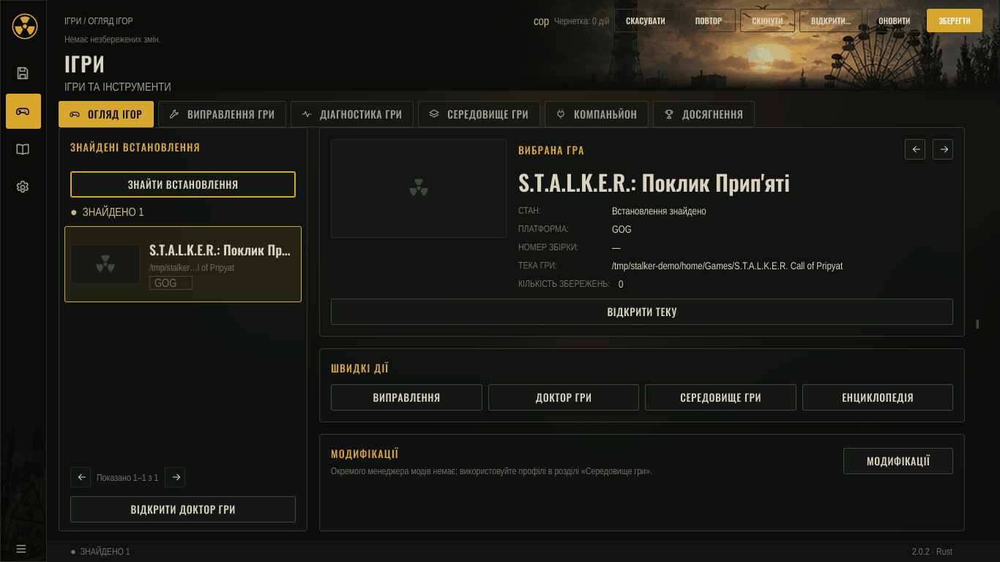

Відкрийте розділ **ІГРИ**. **ЗНАЙТИ ВСТАНОВЛЕННЯ** шукає встановлені ігри (Steam, GOG, Heroic і звичайні теки з
іграми). Клацніть знайдену гру: праворуч видно її платформу, номер збірки, теку та кількість збережень. Стрілки
праворуч угорі перемикають ігри.

- **ВІДКРИТИ ТЕКУ** відкриває теку гри.
- **ШВИДКІ ДІЇ** ведуть на інші екрани для цієї гри: **ВИПРАВЛЕННЯ**, **ДОКТОР ГРИ**, **СЕРЕДОВИЩЕ ГРИ**,
  **ЕНЦИКЛОПЕДІЯ**.

З грою, вибраною тут, працюють екрани виправлень, діагностики, середовища, компаньйона та досягнень. Якщо вашу гру
не знайдено, вкажіть її теку вручну на екрані **КОМПАНЬЙОН**, у блоці **ТЕКА ГРИ (ВРУЧНУ)**.

## 11. Виправлення ігор

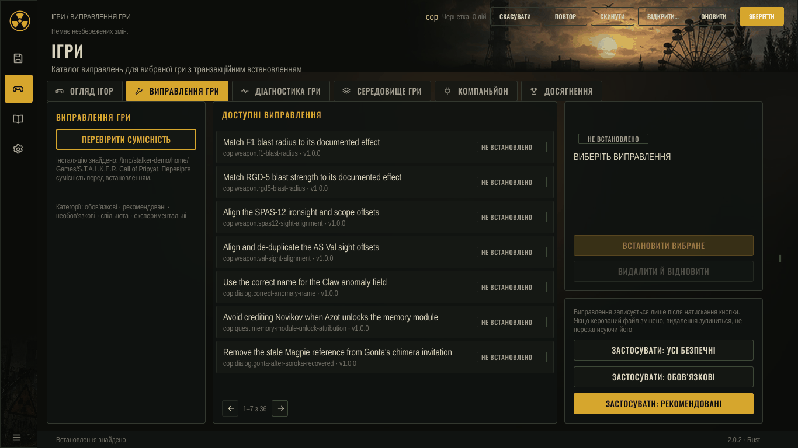

Виправлення лагодять відомі помилки у файлах ігор: неправильні значення зброї, зламані репліки, квести, які не можна
завершити. Вони є для «Тіні Чорнобиля», «Чистого неба», «Поклику Прип'яті» та їхніх Enhanced Edition; для
S.T.A.L.K.E.R. 2 їх немає. Назви виправлень написано англійською будь-якою мовою інтерфейсу.

**Як встановити виправлення:**

1. Закрийте гру. Виберіть її на екрані [ОГЛЯД ІГОР](#10-огляд-ігор).
2. Відкрийте **ВИПРАВЛЕННЯ ГРИ** й натисніть **ПЕРЕВІРИТИ СУМІСНІСТЬ**. Редактор порівняє файли гри з тими, на які
   розраховано кожне виправлення.
3. Клацніть виправлення, щоб прочитати, що воно робить, потім натисніть **ВСТАНОВИТИ ВИБРАНЕ** і **ПІДТВЕРДИТИ**.

Або встановіть набір одразу: **ЗАСТОСУВАТИ: ОБОВ’ЯЗКОВІ**, **ЗАСТОСУВАТИ: РЕКОМЕНДОВАНІ** чи **ЗАСТОСУВАТИ: УСІ
БЕЗПЕЧНІ**.

**Як зняти виправлення:** клацніть його й натисніть **ВИДАЛИТИ Й ВІДНОВИТИ**. Файл гри стане таким, яким був. Якщо ви
або інший мод змінили цей файл після встановлення виправлення, редактор зупиниться і файл не чіпатиме (у
виправлення тоді буде стан **ФАЙЛ ЗМІНЕНО ПІСЛЯ ВСТАНОВЛЕННЯ**).

Виправлення ставиться, лише якщо файл гри точно той, для якого його зроблено; інакше редактор відмовляє й нічого не
змінює. Кілька виправлень під час встановлення завантажують один додатковий файл.

Виправлення звірено з файлами ігор, але в запущеній грі їх ще не перевіряли.

## 12. Компаньйон у грі

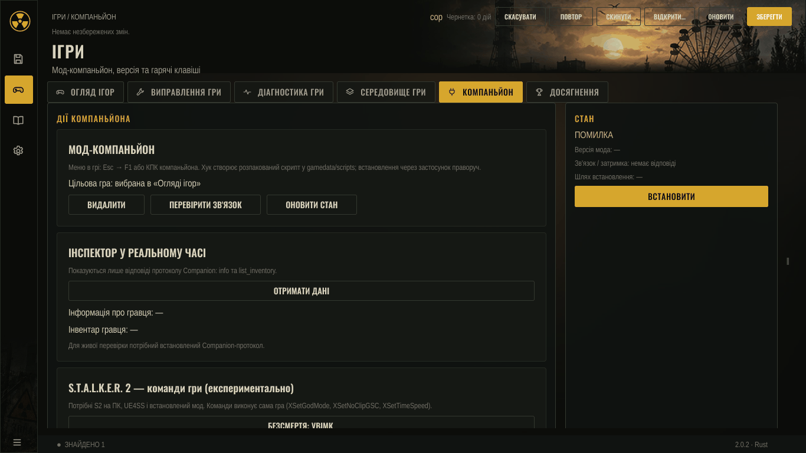

Компаньйон — необов'язковий мод. З ним редактор може діяти на запущену гру без перезавантаження збереження: видати
предмети та гроші, вилікувати, полагодити надягнене, перенести в межах локації, прочитати інвентар.

**Як встановити:**

1. Закрийте гру. Виберіть її на екрані [ОГЛЯД ІГОР](#10-огляд-ігор).
2. Відкрийте **КОМПАНЬЙОН** і натисніть **ВСТАНОВИТИ**, потім **ПІДТВЕРДИТИ**.
3. Стан зміниться на **ВСТАНОВЛЕНО (ОЧІКУВАННЯ ГРИ)**. Запустіть гру й завантажте збереження — стане **ПРАЦЮЄ
   (ПІДКЛЮЧЕНО)**. **ПЕРЕВІРИТИ ЗВ'ЯЗОК** перевіряє це будь-якої миті.

**У грі:** натисніть **Esc**, потім **F1**. Відкриється меню компаньйона.

**У редакторі**, поки гра запущена:

- **ІНСПЕКТОР У РЕАЛЬНОМУ ЧАСІ → ОТРИМАТИ ДАНІ** показує дані гравця та інвентар такими, якими вони є зараз у грі.
- **ГАРЯЧІ КЛАВІШІ**: клавіші для дій **«Лікування»**, **«Ремонт спорядження»**, **«Зберегти позначку»**, **«Перейти до
  останньої позначки»** та **«Швидке збереження»**. Задайте клавіші, натисніть **ЗБЕРЕГТИ КЛАВІШІ**, потім **УВІМКНУТИ
  ГАРЯЧІ КЛАВІШІ**. **ЗА ЗАМОВЧУВАННЯМ** повертає стандартні клавіші.
- **S.T.A.L.K.E.R. 2 — команди гри (експериментально)**: **«Безсмертя»**, **«Політ»**, **«Час ×5»**. Потрібні версія гри
  для ПК з UE4SS і встановлений мод.
- **УСІ ІГРИ → ВСТАНОВИТИ / ОНОВИТИ В УСІ ПОЗНАЧЕНІ** ставить або оновлює компаньйона одразу в кількох іграх.

**Як видалити:** натисніть **ВИДАЛИТИ**. Редактор видалить рівно ті файли, які встановив, і поверне скрипт гри, який
змінював.

**Enhanced Edition.** Для них компаньйон має надходити через Steam Workshop (**ПІДПИСАТИСЯ У STEAM**). Пакети
Workshop ще не опубліковано, тому редактор пише «Пакет Steam Workshop ще не опубліковано».

Із цією версією редактора компаньйона в запущеній грі ще не перевіряли.

## 13. Діагностика збереження, діагностика гри та середовище гри

### Діагностика збереження

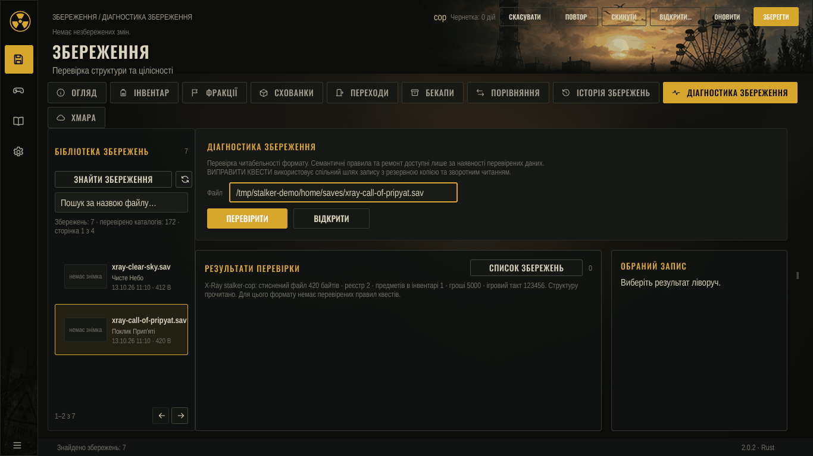

Діагностика збереження читає збереження й каже, чи ціла його структура. Відкрите збереження вже вписано в поле
**«Файл»**; натисніть **ПЕРЕВІРИТИ**. **СПИСОК ЗБЕРЕЖЕНЬ** показує інші збереження для перевірки; **ВІДКРИТИ** відкриває
перевірений файл у редакторі.

Для деяких ігор діагностика знає квести, які можуть «зависнути». Якщо вона знайде такий, запропонує **ВИПРАВИТИ
КВЕСТИ** (виправлення записується як будь-яка інша зміна: з резервною копією та перевіркою) або **ВСТАНОВИТИ
ВИПРАВЛЕННЯ ГРИ**, якщо причина у файлах гри.

### Діагностика гри

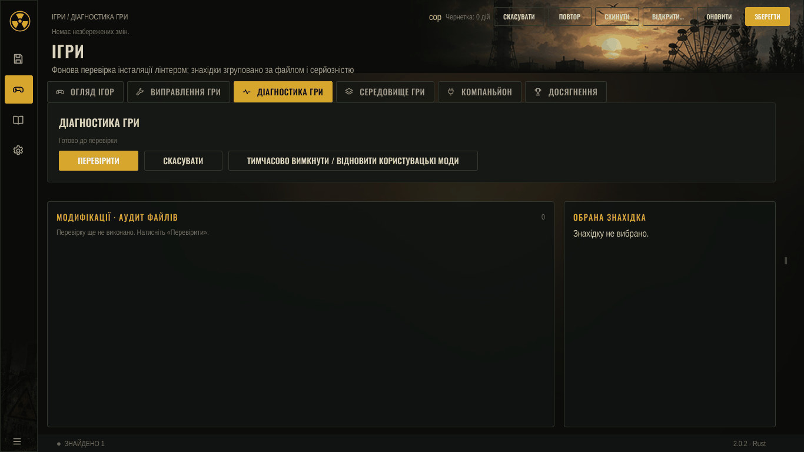

Діагностика гри перевіряє файли та скрипти вибраної гри й показує знахідки, згруповані за файлом і за серйозністю.
Натисніть **ПЕРЕВІРИТИ**; **СКАСУВАТИ** зупиняє перевірку, що триває. Клацніть знахідку, щоб прочитати подробиці
праворуч. Перевірка лише читає файли.

**ТИМЧАСОВО ВИМКНУТИ / ВІДНОВИТИ КОРИСТУВАЦЬКІ МОДИ** — для S.T.A.L.K.E.R. 2: кнопка вимикає ваші моди, щоб
перевірити, чи працює гра без них, і повертає їх назад. Перед цим вона питає підтвердження.

### Середовище гри

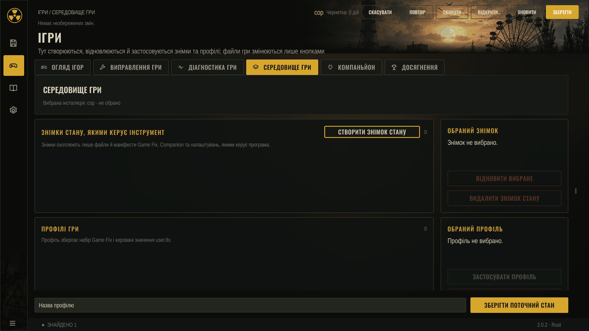

Цей екран запам'ятовує, що сам редактор змінив у грі (виправлення, компаньйон, керовані налаштування), щоб до цього
стану можна було повернутися.

- **ЗНІМКИ СТАНУ, ЯКИМИ КЕРУЄ ІНСТРУМЕНТ**: **СТВОРИТИ ЗНІМОК СТАНУ** запам'ятовує поточний стан. **ВІДНОВИТИ
  ВИБРАНЕ** повертає до нього; **ВИДАЛИТИ ЗНІМОК СТАНУ** прибирає запис. Знімки є лише для ігор на X-Ray.
- **ПРОФІЛІ ГРИ**: впишіть **«Назва профілю»** й натисніть **ЗБЕРІГТИ ПОТОЧНИЙ СТАН** (так кнопку підписано в
  програмі), щоб зберегти набір виправлень і налаштувань під назвою; **ЗАСТОСУВАТИ ПРОФІЛЬ** перемикає на нього;
  **ВИДАЛИТИ ПРОФІЛЬ** прибирає його.

Знімок охоплює лише те, що встановив редактор. Це не копія всієї гри.

## 14. Steam Cloud і досягнення

Обом екранам потрібен запущений Steam, у який виконано вхід.

### Хмара

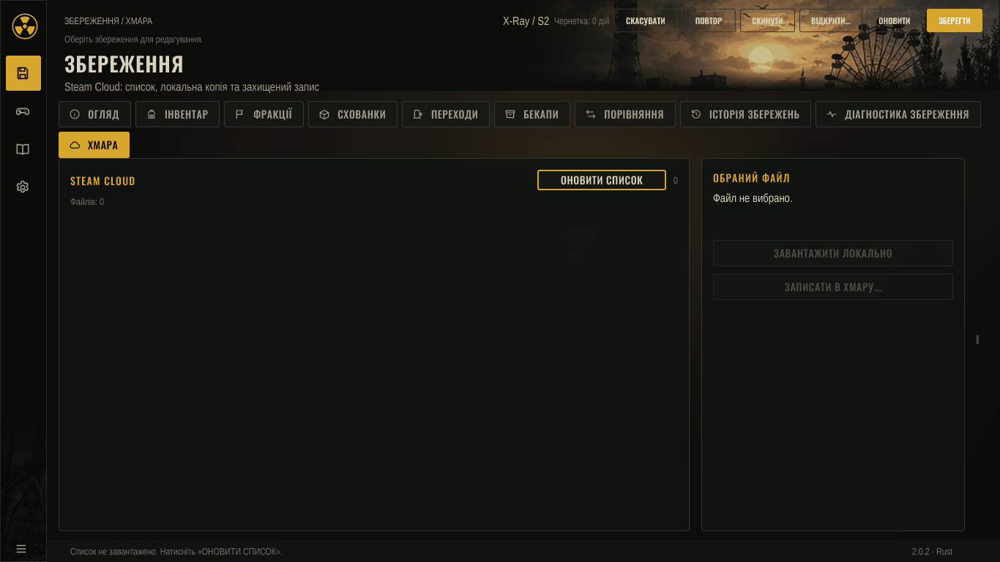

**ОНОВИТИ СПИСОК** показує збереження вибраної гри, що лежать у Steam Cloud. Клацніть файл, потім:

- **ЗАВАНТАЖИТИ ЛОКАЛЬНО** копіює його на комп'ютер, щоб його можна було відкрити й редагувати.
- **ЗАПИСАТИ В ХМАРУ...** замінює хмарний файл вашим локальним збереженням. Редактор показує обидва файли, просить
  поставити позначку **«Підтверджую перезаписування»**, і лише після цього працює кнопка **ЗАПИСАТИ**. Якщо запис у
  хмару обірвався посередині, редактор не повторює його сам.

Записування збережень S.T.A.L.K.E.R. 2 у Steam Cloud вимкнено.

### Досягнення

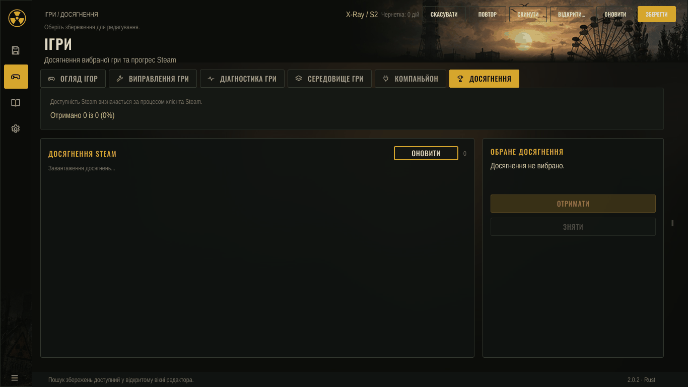

**ОНОВИТИ** читає досягнення вибраної гри зі Steam. Клацніть досягнення й натисніть **ОТРИМАТИ** або **ЗНЯТИ**;
редактор попросить підтвердити. Зміна робиться у вашому обліковому записі Steam, а не у збереженні, і її видно у
Steam.

## 15. Енциклопедія

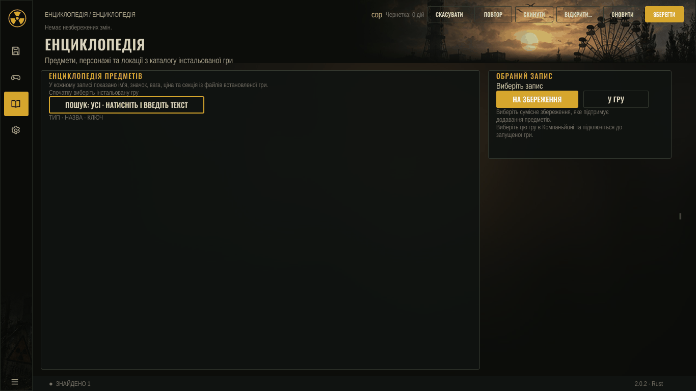

Енциклопедія показує предмети встановленої гри: назви, значки, вагу та ціну, прочитані з файлів самої гри. Спершу
виберіть гру на екрані [ОГЛЯД ІГОР](#10-огляд-ігор). Натисніть **ПОШУК** і вводьте текст, щоб відібрати записи.

Для вибраного запису **НА ЗБЕРЕЖЕННЯ** додає предмет до відкритого збереження (правила ті самі, що в розділі
[«Додавання предмета»](#6-додавання-предмета)), а **У ГРУ** видає його в запущеній грі через
[компаньйона](#12-компаньйон-у-грі).

## 16. Оновлення

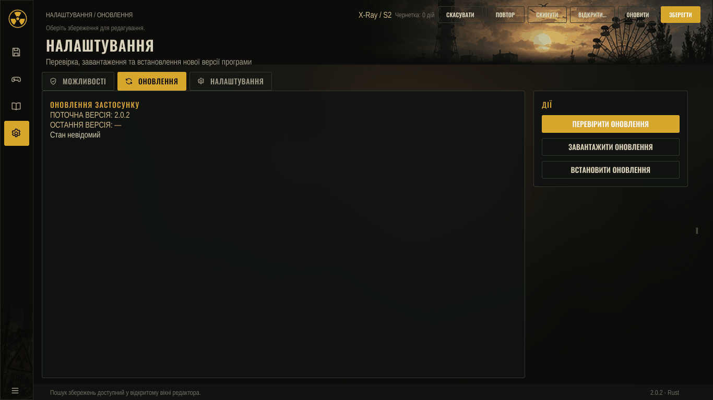

Редактор перевіряє нову версію, лише коли ви про це просите.

1. **НАЛАШТУВАННЯ → ОНОВЛЕННЯ → ПЕРЕВІРИТИ ОНОВЛЕННЯ**.
2. Якщо оновлення є, натисніть **ЗАВАНТАЖИТИ ОНОВЛЕННЯ**, потім **ВСТАНОВИТИ ОНОВЛЕННЯ**.

Перед завантаженням редактор перевіряє підпис списку оновлень і відмовляється від файлу, який із ним не збігається.
Версія, встановлена інсталятором Windows, і версія з `.deb` ставлять оновлення самі (`.deb` спитає пароль); у macOS
редактор відкриває завантажений образ. AppImage сам не оновлюється: завантажте новий файл зі сторінки випуску. Якщо
редактор пише «Для цієї інсталяції немає пакета», зробіть так само.

## 17. Налаштування, мова та можливості

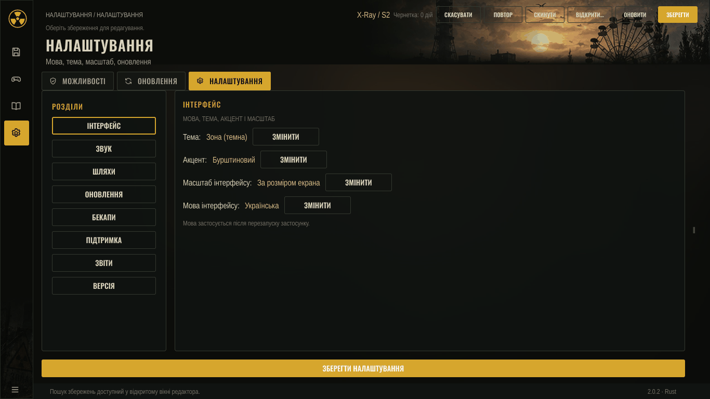

Відкрийте **НАЛАШТУВАННЯ → НАЛАШТУВАННЯ**. Виберіть розділ ліворуч, а коли закінчите, натисніть **ЗБЕРЕГТИ
НАЛАШТУВАННЯ** внизу.

| Розділ | Що там |
|---|---|
| **ІНТЕРФЕЙС** | **Тема** («Зона (темна)», «Чисте небо», «День»), колір **акценту**, **масштаб інтерфейсу** (за розміром екрана або 100–200 %), **мова інтерфейсу**. Кожна кнопка **ЗМІНИТИ** перемикає на наступне значення. |
| **ЗВУК** | Звуки інтерфейсу та музика меню: увімкнути, вимкнути, гучність. |
| **ШЛЯХИ** | Теки, у яких редактор шукає збереження. |
| **ОНОВЛЕННЯ** | Перехід на екран оновлень. |
| **БЕКАПИ** | Тека резервних копій (**ОГЛЯД…**) і перехід до Steam Cloud (**ВІДКРИТИ STEAM CLOUD**). |
| **ПІДТРИМКА** | **«Перевірити оточення»** та **«Зберегти звіт…»** — файл, який додають до повідомлення про помилку. |
| **ЗВІТИ** | Чи надсилати анонімні звіти про помилки, і окрема згода на статистику продуктивності. |
| **ВЕРСІЯ** | Версія редактора. |

**Мова.** Натискайте **ЗМІНИТИ** поруч із **«Мова інтерфейсу»**, доки не побачите свою, натисніть **ЗБЕРЕГТИ
НАЛАШТУВАННЯ** й перезапустіть редактор. Мов 15: російська, українська, англійська, німецька, французька,
італійська, іспанська, польська, чеська, бразильська португальська, турецька, японська, корейська, китайська
спрощена й традиційна. Переклади не вичитано носіями мов; для китайської, японської та корейської потрібен
системний шрифт із цими знаками.

**Приватність.** Без вашої згоди нічого не надсилається. У звітах про помилки немає ваших збережень, шляхів до
файлів та ігрових журналів. Звіт, збережений кнопкою **«Зберегти звіт…»**, лишається на комп'ютері, доки ви самі його
кудись не додасте.

### Можливості

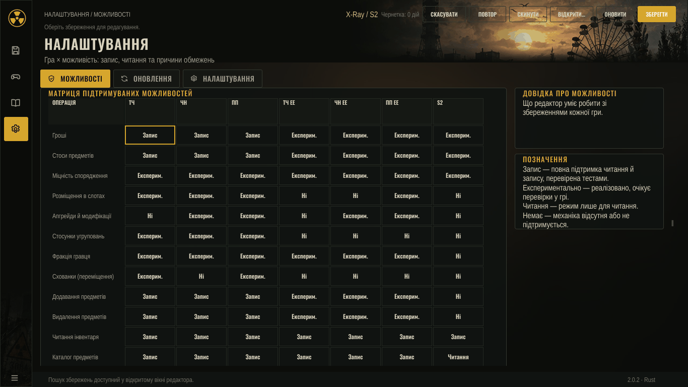

**НАЛАШТУВАННЯ → МОЖЛИВОСТІ** — таблиця того, що редактор уміє в кожній грі. Стовпці — ігри (ТЧ, ЧН, ПП, їхні
Enhanced Edition, S2), рядки — види змін.

- **Запис**: підтримується повністю.
- **Експерим.**: зроблено, але у грі ще не перевірено.
- **Читання**: показується, змінювати не можна.
- **Ні**: недоступно.

Клацніть клітинку, щоб прочитати причину. Одна клітинка в цій версії застаріла: перенесення зі схованок для
S.T.A.L.K.E.R. 2 позначено **«Ні»**, хоча воно доступне на екрані [«Схованки»](#8-схованки). Рядок **«Фракція
гравця»** описує те, що редактор уміє записати, але кнопки для цього поки що немає на жодному екрані.

## 18. Версія для браузера

[stalker-save-editor.pages.dev](https://stalker-save-editor.pages.dev) — той самий редактор, що працює всередині
вебсторінки.

1. Натисніть **ВІДКРИТИ…** і виберіть файл збереження.
2. Редагуйте його так, як описано вище.
3. Натисніть **ЗБЕРЕГТИ**. Браузер завантажить змінену копію. Покладіть її до теки збережень гри самі; файл, який ви
   відкривали, не змінюється.

Збереження читається й змінюється всередині вашого браузера і нікуди не вивантажується.

**Чим відрізняється від встановленої програми:**

- Вона не може шукати збереження на диску й писати до теки гри, тому відкриття та збереження робляться вручну.
  Файл, який ви відкривали, лишається на диску без змін — це і є ваша резервна копія: не затирайте його, доки гра
  не завантажить змінену копію.
- Є лише екрани розділу «Збереження», **МОЖЛИВОСТІ** та **НАЛАШТУВАННЯ**. Немає розділу «Ігри» (виправлення,
  компаньйон, діагностика гри, досягнення), немає Steam Cloud, енциклопедії та оновлень: сторінка завжди останньої
  версії.
- Значки предметів підвантажуються за мить після відкриття сторінки.

## 19. Якщо щось пішло не так

**Гра не завантажує змінене збереження, або в ньому щось не так.**
Поверніть оригінал: [БЕКАПИ → «Відновити на місце…» → «Підтвердити відновлення»](#9-резервні-копії-історія-та-порівняння).
Потім, будь ласка, повідомте, яка це була гра і яка зміна.

**Кнопка «ЗБЕРЕГТИ» відмовляється записувати.**
- Запущено гру: закрийте її й натисніть **ЗБЕРЕГТИ** ще раз.
- Зміна недоступна для цієї гри: про це сказано в повідомленні. Див. [«Відомі обмеження»](#20-відомі-обмеження).
- Файл збереження змінився на диску після того, як ви його відкрили (наприклад, гра збереглася поверх): натисніть
  **ОНОВИТИ** і зробіть зміну знову.

**Збереження не відкривається.**
Редактор пише, що файл — не збереження S.T.A.L.K.E.R. або його пошкоджено. Подробиці покаже
[ДІАГНОСТИКА ЗБЕРЕЖЕННЯ](#13-діагностика-збереження-діагностика-гри-та-середовище-гри). Збереження сильно
модифікованої гри може не читатися.

**Редактор не знаходить мої збереження або гру.**
Додайте теку зі збереженнями вручну ([майстер першого запуску](#2-перший-запуск-і-пошук-збережень) або
**НАЛАШТУВАННЯ → ШЛЯХИ**) чи відкрийте файл кнопкою **ВІДКРИТИ…**. Для гри вкажіть теку в **КОМПАНЬЙОН → ТЕКА ГРИ
(ВРУЧНУ)**.

**Linux: вікно не з'являється.**
Версії до 2.0.2 не запускалися в GNOME на Wayland: завантажте останній випуск. Для AppImage перевірте, що
дозволено запуск файлу як програми. Інші стільниці на Wayland (KDE, Sway) не перевіряли.

**Windows або антивірус блокує інсталятор.**
Інсталятор не підписано. Натисніть **«Докладніше»** (More info) → **«Усе одно запустити»** (Run anyway). Щоб
переконатися, що файл справжній, порівняйте його SHA-256 із файлом `.sha256`, який лежить поруч на сторінці випуску.

**Як повідомити про проблему.**
Відкрийте **НАЛАШТУВАННЯ → ПІДТРИМКА**, натисніть **«Зберегти звіт…»** і додайте файл до нового
[повідомлення](https://github.com/Dmitriy-DE/stalker-save-editor-rs/issues). Напишіть, яка гра, яка зміна і що
сталося. Не додавайте всю теку збережень: досить одного збереження, на якому видно проблему.

## 20. Відомі обмеження

**Не перевірено в іграх.** Зміни «Тіні Чорнобиля», «Чистого неба», трьох Enhanced Edition і S.T.A.L.K.E.R. 2 в іграх
не завантажували; завантажено одне змінене збереження «Поклику Прип'яті». Компаньйона та виправлення ігор у
запущеній грі не перевіряли. Звук ніхто не слухав.

**Людина не запускала:** збірки для Windows і macOS. Образи macOS не підписано.

**S.T.A.L.K.E.R. 2**

- Предмети не можна додавати й видаляти.
- Модифікації, розміщення предметів і стосунки з угрупованнями не редагуються.
- Збереження, зроблені у грі версії 1.0.x, читаються, але не редагуються: спершу завантажте й збережіть їх у
  поточній версії гри.
- Записувати збереження до Steam Cloud із редактора не можна.

**«Тінь Чорнобиля», «Чисте небо», «Поклик Прип'яті»**

- «Тінь Чорнобиля»: модифікації не редагуються.
- «Чисте небо»: предмети не можна забрати зі схованок.
- «Тінь Чорнобиля» та «Поклик Прип'яті»: предмет, який редактор забрав зі схованки, не можна повернути назад, доки
  гра хоча б раз не збережеться з ним.

**Enhanced Edition**

- Стосунки з угрупованнями не редагуються, предмети зі схованок забрати не можна, персонажа не можна перенести на
  іншу локацію.
- «Тінь Чорнобиля» EE і «Чисте небо» EE: предмети не можна перекладати між слотами, поясом і рюкзаком.
- «Тінь Чорнобиля» EE: модифікації не редагуються.
- Пакети компаньйона для Steam Workshop ще не опубліковано.

**Інше**

- Кнопки для зміни фракції гравця немає, хоча в таблиці можливостей такий рядок є.
- Репозиторію APT поки що немає; `.deb` ставиться вручну, а оновлюється з редактора.
- Переклади не вичитано носіями мов. Подекуди видно текст іншою мовою (наприклад, назви предметів і угруповань
  російською, назви виправлень англійською).

Повна таблиця — у [CAPABILITIES.md](CAPABILITIES.md) (англійською); нотатки про випуски —
[2.0.0](RELEASE_NOTES_2.0.0.md), [2.0.1](RELEASE_NOTES_2.0.1.md) та [2.0.2](RELEASE_NOTES_2.0.2.md).

*Це неофіційний фанатський проєкт. Його не створила, не схвалила й не підтримує GSC Game World.*
